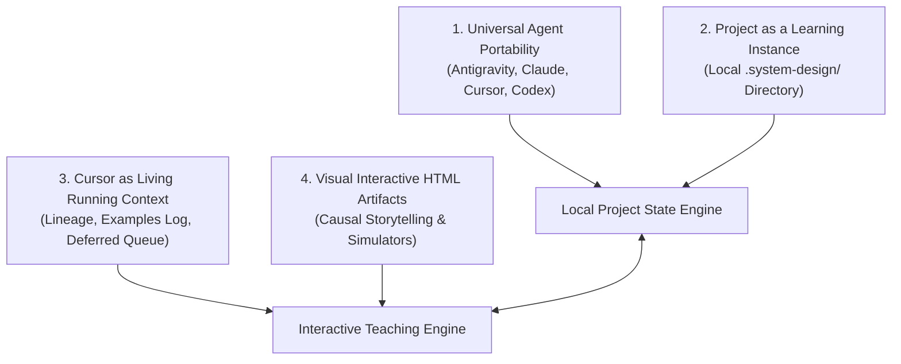

# 🏛️ System Design Studio

[](https://agentskills.io)
[](LICENSE)
[](README.md)
[](https://alph-a07.github.io/system-design-studio)
[](https://buymeacoffee.com/itsjeel01)

> **Connected Engineering & Project-Based System Design Learning for AI Agents**  
> *Transform technical system design from superficial buzzword memorization into first-principles causal reasoning, living cursor state retention, and interactive visual simulators.*

---

## 🎯 What is System Design Studio?

**System Design Studio** is an open, portable, agent-agnostic learning studio that runs directly inside your codebase or project repository. It teaches Low-Level Design (LLD), High-Level Design (HLD), distributed systems, infrastructure mechanisms, and mobile architecture across a **50-cluster canonical roadmap** (354 topics).

### Why Most System Design Prep Fails:
* **The "Magic Box" Trap**: Treating components (Kafka, Redis, Cassandra) as magic answers rather than trade-off implementations of physical hardware and algorithmic constraints.
* **Cognitive Fragmentation**: Tutors jumping between random, disconnected examples every turn without causal continuity.
* **Fragile Cloud Dependencies**: Heavy lock-in to external databases (Notion) or drawing boards that break across environments, leak private workspaces, and fail offline.

### The 4 Pillars of the Studio:


1. **Universal Agent Portability**: Zero proprietary runtime lock-in. 100% compliant with the open Agent Skills standard. Operates seamlessly whether hosted in Google Antigravity, Claude Code, Cursor, Codex, or Gemini CLI.
2. **Project as a Learning Instance**: No external accounts, no cloud database locks, no Notion API keys, and no drawing board logins. Learning state resides entirely in a local `.system-design/` folder in your project, version-controlled by standard Git.
3. **Cursor & Curriculum as the Sole Shared Context**:
   - **`CURRICULUM.md`**: Master 50-cluster syllabus with 354 topics and actionable tick-off rules.
   - **`CURSOR.md`**: The living operational brain tracking active focus, target depth, causal lineage (backward anchor & forward hook), domain examples registry (`examplesTaken`), and pending deferred questions (`deferredQueue`).
4. **Interactive HTML Lesson Artifacts**: Lessons are delivered not as flat, dry bullet points, but as **carefully crafted, beautifully styled, interactive HTML artifacts** with embedded JavaScript simulators, SVG sequence traces, invariant matrices, and active reality checks.

---

## 🏗️ The Project-as-a-Learning-Instance Model

Every learning workspace is a self-contained Git repository:

```text
my-system-design-project/
├── .git/
├── .system-design/
│   ├── manifest.json              # Canonical machine-readable state (schema v2.0)
│   ├── CURSOR.md                  # Living running context (brain of the instance)
│   ├── CURRICULUM.md              # Master 50-cluster syllabus with checkboxes
│   ├── DECISIONS.md               # Accepted Architecture Decision Records (ADRs)
│   └── lessons/                   # Standalone interactive HTML lesson artifacts
│       ├── topic-0.1-tcp-vs-udp.html
│       ├── topic-0.2-http-quic.html
│       └── ...
├── notes/                         # Optional personal markdown study notes
└── README.md
```

### Zero-Cloud Privacy Invariant
* **Your code never leaves your machine.**
* **Personal notes remain 100% your own.**
* The studio only reads and updates `.system-design/` within your current project root.

---

## ⚡ 1-Minute Quickstart

### 1. Initialize a Learning Instance
Run the scaffolding script inside any new or existing project directory:

```bash
skills/system-design-studio/scripts/init-learning-instance.sh "My System Design Journey"
```

This scaffolds `.system-design/` with the complete 50-cluster curriculum, template cursor, and manifest at pristine 0% state.

### 2. Verify Instance Health
Run the automated diagnostic and verification suite:

```bash
python3 skills/system-design-studio/scripts/verify-instance.py .system-design
```

### 3. Check Live Running Context
Inspect your active topic, progress percentage, examples log, and deferred questions:

```bash
python3 skills/system-design-studio/scripts/sync-status.py .system-design
```

### 4. Advance the Cursor Idempotently
When an agent or learner completes a topic:

```bash
python3 skills/system-design-studio/scripts/advance-cursor.py \
  --complete-topic topic.0.1.tcp-vs-udp \
  --evidence "Learner traced TCP sequence numbering and receive window bufferbloat" \
  --log-example-domain "Financial Ledger" \
  --log-example-scenario "Merchant payment idempotency key retry on TCP timeout" \
  --next-topic-id topic.0.1.http-1-1-vs-http-2-vs-http-3 \
  --next-action "Establish topic foundation for HTTP/1.1 vs HTTP/2 vs HTTP/3 (HOL blocking)" \
  --lesson-artifact .system-design/lessons/topic-0.1-tcp-vs-udp.html
```

---

## 📦 Installation Across AI Agent Platforms

### Google Antigravity
To install as a native plugin:
```bash
agy plugin add https://github.com/alph-a07/system-design-studio.git
```
Or clone into your local skills directory:
```bash
cp -r skills/system-design-studio ~/.gemini/antigravity/skills/
```

### Claude Code
Clone into your personal or workspace skills directory:
```bash
git clone https://github.com/alph-a07/system-design-studio.git ~/.claude/skills/system-design-studio
```

### Cursor
Add as a project skill or workspace rule:
```bash
git submodule add https://github.com/alph-a07/system-design-studio.git .cursor/skills/system-design-studio
```

### OpenAI Codex / Gemini CLI
Copy the `skills/system-design-studio` directory into your active agent workspace or path.

---

## 🎨 Bring-Your-Own (BYO) & Customization

System Design Studio is completely curriculum-agnostic:

### 1. Bring Your Own Curriculum (Markdown Syllabus)
Import any custom markdown syllabus (e.g. specialized trading architecture, ML platform engineering, or team onboarding):

```bash
python3 skills/system-design-studio/scripts/import-curriculum.py \
  --input my-team-curriculum.md \
  --instance-dir .system-design \
  --title "Low-Latency Trading Architecture" \
  --domain "Order Matching Engines"
```

### 2. Bring Your Own Flagship Domain
Set `flagshipDomain` in `.system-design/CURSOR.md` (e.g., `Autonomous Vehicles`, `Fintech`, `Healthcare Imaging`). The tutor automatically anchors all subsequent traces and reality checks around your chosen vertical.

*Read the complete customization guide*: [`skills/system-design-studio/references/bring-your-own-curriculum.md`](file:///Users/itsjeel01/Developer/system-design-studio/skills/system-design-studio/references/bring-your-own-curriculum.md)

---

## 🧠 Longevity Pedagogy: Kleppmann Meets Xu

System Design Studio bridges the two foundational schools of distributed architecture:

| Dimension | Martin Kleppmann (*Designing Data-Intensive Applications*) | Alex Xu (*System Design Interview* series) |
| :--- | :--- | :--- |
| **Primary Focus** | Bottom-up physical mechanics, storage engines, consensus, invariants. | Top-down scoping, quantitative estimation, component trade-off matrices. |
| **Mental Model** | Hardware latency hierarchy, write-ahead logs, 2PC, quorums, failure modes. | Peak QPS, storage footprint, 80/20 caching, high-level blueprints. |
| **Studio Integration** | The physical justification: why trivial software approaches break down. | The engineering structure: bounding problems and sizing hardware resources. |

---

## 🌐 Product Documentation Site

Visit the live site: **[https://alph-a07.github.io/system-design-studio](https://alph-a07.github.io/system-design-studio)**

* **Interactive 50-Cluster Syllabus Explorer**: Filter, search, and view all 354 topics and tick-off rules across 6 engineering tiers.
* **Architecture & Memory Hierarchy Guide**: Technical specifications of the Project Learning Instance and Living Cursor.
* **CLI Reference & Guides**: Quickstart instructions for `init`, `advance`, `sync`, and `import-curriculum`.

---

## ☕ Support the Project

If you find System Design Studio valuable for mastering distributed systems and level-setting your system design intuition, consider supporting its open-source development:

[](https://buymeacoffee.com/itsjeel01)

---

## 📜 License & Community

- **License**: MIT License ([LICENSE](LICENSE))
- **Contributing**: Please read [CONTRIBUTING.md](CONTRIBUTING.md) and [CODE_OF_CONDUCT.md](CODE_OF_CONDUCT.md).
- **Issues & Discussions**: Use our [Issue Templates](.github/ISSUE_TEMPLATE/) or start a GitHub Discussion.
