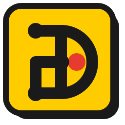

<p align="center">
  <a href="https://alph-a07.github.io/system-design-studio">
    
  </a>
</p>

<h1 align="center">System Design Studio</h1>

<p align="center">
  <strong>Master real-world distributed systems and architecture with the AI coding agent you already use.</strong>
</p>

<p align="center">
  <a href="https://agentskills.io"></a>
  <a href="LICENSE"></a>
  <a href="README.md"></a>
  <a href="https://alph-a07.github.io/system-design-studio"></a>
  <a href="https://github.com/alph-a07/system-design-studio"></a>
  <a href="https://github.com/sponsors/alph-a07"></a>
  <a href="https://buymeacoffee.com/itsjeel01"></a>
</p>

---

## Why System Design Studio?

Most engineers study system design by skimming static diagrams, memorizing high-level cheat sheets, or asking conversational chatbots that nod along to every hand-waving answer. When real production chaos strikes—or a Staff+ interviewer probes: *"What happens to your tail latency when packet loss hits 1%?"*—the illusion of understanding evaporates.

**System Design Studio turns your AI coding agent (Antigravity, Claude Code, Cursor, Codex) into a rigorous, interactive systems engineering studio.** It runs 100% locally in your project repository, pairs deep causal storytelling with tactile visual simulators, tests your trade-offs cold in chat against production failure modes, and commits verified architectural proof directly into your Git history.

```text
  ┌─────────────────────────────────────────────────────────────────────────────┐
  │                                                                             │
  │   1. DELIVER (/sds-teach)         2. SELF EVALUATE (Closure)    3. VERIFY   │
  │   Tactile HTML Simulators    ──►  Conclude On Your Terms    ──► Git Proof & │
  │   & Inline Jargon Tooltips        When You Have Closure         Living Notes│
  │                                                                             │
  └─────────────────────────────────────────────────────────────────────────────┘
```

---

## 7 Superpowers You Get

### 1. Hands-On Visual Failure Simulators
Don't just read abstract descriptions of head-of-line blocking, write amplification, or quorum loss. Turn parameter dials, inject 2% packet loss or kill a replica node, and watch socket buffers stall, SSTables compact, or split-brain partitions unfold in standalone interactive browser simulators.

### 2. Zero-Friction Inline Jargon Tooltips (No Tab Switching)
Never break your reading flow or tab out to Google systems buzzwords. Protocol keywords and acronyms (*Middlebox, BDP, ALPN, HoL Blocking, Write Amplification, P99, 4-Tuple*) are unpacked as **inline interactive tooltips** right inside the sentence where they appear—plain English first, formal systems label second—with an auto-indexed glossary drawer.

### 3. Self Evaluation (Conclude On Your Terms)
No stressful interrogation gates or adversarial friction. Every topic pairs tactile simulators with a realistic Self Evaluation scenario. Once you explore the mechanics and reach internal closure on the trade-offs, conclude the topic on your own terms directly in chat or seal it with `/sds-complete`.

### 4. Active-Learning Living Notes (Your Personal Second Brain)
Traditional courses dump generic textbook bullet points. System Design Studio automatically synthesizes what **you personally proved and understood** across 4 cognitive phases:
1. **Initial Intuition & Working Hypothesis**: Your naive mental model before constraint analysis.
2. **Discussion & Friction Explored**: The failure modes and edge cases where your initial model broke down.
3. **Derived Invariant (The 'Aha!' Synthesis)**: The non-negotiable physical or mathematical law you proved cold.
4. **Personal Rules of Thumb & Sizing Reality**: Actionable quantitative heuristics ready for interviews and production.

Saved directly in your repository in Markdown, compatible with Obsidian, VS Code, and Foam.

### 5. Built-in Quantitative Sizing & Math Engine
Never guess resource requirements or write ad-hoc calculation scripts. Built-in, battle-tested formulas for rapid systems estimation:
- **Bandwidth-Delay Product (`calculate_bdp`)**: Computes bytes in flight and throughput caps for unscaled 64KB TCP windows.
- **Little's Law (`calculate_littles_law`)**: Concurrency $L = \lambda \times W$ and $10\times/50\times$ latency spike surge models.
- **Quorum Intersection (`calculate_quorum`)**: Majority quorum $Q = \lfloor N/2 \rfloor + 1$, fault tolerance $F$, and even-node waste analysis.
- **Consistent Hashing Migration (`calculate_consistent_hash_migration`)**: $K/(N+1)$ blast radius vs. modulo rehash cascades.
- **Cache Sizing (`calculate_cache_sizing`)**: 80/20 Pareto working set RAM, peak QPS, and network egress bandwidth.
- **Token Bucket Rate Limiting (`calculate_token_bucket`)**: Burst capacity, sustained RPS, and refill dynamics.
- **Bloom Filters (`calculate_bloom_filter`)**: Required bits $m$, memory footprint in MB, and optimal hash count $k$.

*Usable directly via CLI (`python3 lesson_builder.py --calc bdp`) or in-code imports.*

### 6. Live Localhost Workbench (`sds dashboard`)
Launch `http://localhost:8420` to access a distraction-free command center:
- Visual interactive roadmap across 50 clusters and 354 topics
- Live artifact viewer for compiled HTML simulators
- Spaced-repetition **Revision Mode** flashcards auto-compiled from your verified ADRs
- Real-time Git status sync with zero manual page refreshes

### 7. 100% Private, Local & Yours Forever (Zero Cloud Lock-In)
- **Zero Subscriptions**: 100% free, MIT-licensed open source.
- **Zero Cloud Accounts**: All state lives in `.system-design/` inside your Git repo.
- **Survives Context Resets**: The living cursor (`CURSOR.md`) maintains active focus, verified invariants, and deferred questions across chat resets and model switches.
- **Verifiable Proof of Work**: Every completed topic creates an atomic Git commit (`sds(learn): complete ...`) and logs an interview-ready Architecture Decision Record in `DECISIONS.md`.

---

## Quickstart: Up and Running in 30 Seconds

System Design Studio requires no databases and no complex dependencies—just standard Python 3.10+ and standard Bash.

### Step 1: Install Globally (Run Once)

```bash
# macOS / Linux:
curl -fsSL https://raw.githubusercontent.com/alph-a07/system-design-studio/main/install.sh | bash

# Windows (PowerShell):
irm https://raw.githubusercontent.com/alph-a07/system-design-studio/main/install.ps1 | iex
```

*Auto-detects Google Antigravity, Anthropic Claude Code, Cursor IDE, and OpenAI Codex, registering the studio skill and adding `sds` to your PATH.*

---

### Step 2: Initialize Your Learning Workspace

Navigate to any Git repository (or run standalone in a dedicated learning folder):

```bash
sds init
```

**Choose your curated goal track:**
- ⚡ **`interview-sprint`**: 15 high-yield clusters (114 topics) targeting Senior/Staff systems rounds.
- 🧱 **`distributed-systems`**: 23 clusters (171 topics) on consensus, storage engines, and replication.
- 🏛️ **`staff-architect`**: 25 clusters (184 topics) on failure domains, cross-region resilience, and ADR defense.
- 📱 **`mobile-offline`**: 16 clusters (113 topics) on SQLite sync, battery constraints, and optimistic UI.
- 🎓 **`full-mastery`**: The complete canonical 50-cluster, 354-topic systems syllabus across all 5 tiers.
- 🎯 **Or Bring Your Own (BYO)**: Import any custom Markdown syllabus (`sds init --byo path/to/syllabus.md`).

---

### Step 3: Pure In-Chat Learning Workflow

Once initialized, **you never need to touch the terminal during study sessions**. Open your AI coding agent and drive everything naturally in chat:

```text
1. /sds-teach [topic]     ──► Deliver interactive visual lesson & opening dilemma
2. Self Evaluation         ──► Gain closure on trade-offs & conclude on your terms
3. /sds-complete          ──► Seal verified mastery into Git with auto-synthesized notes
```

#### Companion Commands Available Anytime:
| Command | What It Does |
| :--- | :--- |
| **`/sds-teach [topic]`** | Delivers the next or specified topic with tactile simulators, deep mechanics, and inline tooltips. |
| **Self Evaluation** | Review realistic scenario constraints and gain closure on your terms directly in chat. |
| **`/sds-complete [proof]`** | Verifies criteria, advances cursor, logs an ADR, and records an atomic Git commit. |
| **`/sds-status`** | Instant overview of current focus, completed percentage, and lineage anchors. |
| **`/sds-notes [topic]`** | Browses synthesized active learning notes (Hypothesis ➔ Friction ➔ Invariant ➔ Rules). |
| **`/sds-dashboard`** | Launches the live interactive visual workbench on `http://localhost:8420`. |
| **`/sds-curriculum`** | Reorders clusters, prunes topics, or checks off custom objectives. |
| **`/sds-config [k] [v]`** | Customizes visual theme (`slate-clean`, `editorial-paper`, `midnight-neon`, `nordic-frost`, `warm-amber`) or note structure. |
| **`/sds-rollback`** | Safely restores curriculum or learning state to a prior atomic checkpoint. |
| **`/sds-projects`** | Switches between multiple isolated learning workspaces across your machine. |
| **`/sds-update`** | Checks for studio improvements on-demand (zero silent telemetry). |

---

## The Project Learning Instance Model

Every learning workspace is a self-contained Git repository:

```text
my-project/
├── .git/
├── .system-design/
│   ├── manifest.json              # Canonical machine-readable state
│   ├── settings.json              # Theme & delivery preferences (5 visual styles)
│   ├── CURSOR.md                  # Living running context (brain of the instance)
│   ├── CURRICULUM.md              # Master syllabus checklist
│   ├── DECISIONS.md               # Accepted Architecture Decision Records (ADRs)
│   └── lessons/                   # Standalone interactive HTML simulators & lessons
│       ├── 0-1-tcp-vs-udp.html
│       └── ...
├── notes/                         # Your synthesized personal active-learning notes
│   ├── tier-0/
│   │   └── cluster-0-1-network-transport/
│   │       └── 0-1-tcp-vs-udp.md
│   └── ...
└── README.md
```

### Visual Themes & Styling (`settings.json`)

Choose the aesthetic that matches your workflow or customize anytime:

| Theme ID | Aesthetic | Mode | Character |
| :--- | :--- | :--- | :--- |
| **`slate-clean`** *(Default)* | Modern Slate | Dark | Deep slate background (`#0f172a`), vibrant blue accents, modern IDE feel. |
| **`editorial-paper`** | Clean Editorial | Light | High-readability warm off-white paper (`#fbfbfa`), charcoal text, ink accents. |
| **`midnight-neon`** | Cyber Obsidian | Dark | Pitch black obsidian (`#05070c`), electric cyan and mint neon highlights. |
| **`nordic-frost`** | Nordic Frost | Dark | Polar night cool slate (`#2e3440`), frosty teal accents, calm zero-eye-strain. |
| **`warm-amber`** | Warm Amber | Dark | Deep espresso stone (`#1c1917`), rich warm amber & copper accents for night reading. |

---

## Canonical 5-Tier Syllabus (50 Clusters, 354 Topics)

| Tier | Focus Area | Clusters | Topics | Key Subject Matter |
| :--- | :--- | :--- | :--- | :--- |
| **Tier 0** | Foundations & Transport | 5 (0.1–0.5) | 37 | Socket buffers, TLS 1.3 handshake latency, HTTP/2 multiplexing, QUIC packet formats, latency math. |
| **Tier 1** | LLD & Object Modeling | 14 (1.1–1.14) | 94 | Cache eviction (W-TinyLFU/LRU), connection pool starvation, rate limiters, thread pools, lock-free queues. |
| **Tier 2** | HLD & Distributed Infra | 18 (2.1–2.18) | 134 | Consistent hashing, LSM-Trees vs. B-Trees, Raft/Paxos quorums, event sourcing, CDC, 2PC vs. Sagas. |
| **Tier 3** | Mobile Systems & Offline | 11 (3.1–3.11) | 76 | Radio battery limits, delta mutation queues, optimistic UI reconciliation, SQLite caching, push delivery. |
| **Tier 4** | ADRs & Self Evaluation | 2 (4.1–4.2) | 13 | Architectural Decision Records (ADRs), mock architecture self evaluation, trade-off articulation, spaced review. |

Explore the complete interactive syllabus with search and progress tracking on the **[Documentation Site](https://alph-a07.github.io/system-design-studio/curriculum.html)**.

---

## System Design Studio vs. Traditional Study

| Capability | Static Books & Videos | Standard AI Chatbots | System Design Studio |
| :--- | :--- | :--- | :--- |
| **Progression Verification** | None (passive reading) | Nods along; says "Great job!" to anything | **Self Evaluation Gate**: Proves you understand trade-offs and conclude on your terms |
| **Visual Mechanics** | Static 2D diagrams | Wall of generic Markdown text | **Tactile Simulators**: Inject packet loss, kill nodes, tweak concurrency dials |
| **Jargon Friction** | Leaves you to search terms | Uses dense buzzwords unchecked | **Inline Tooltips**: Tap/hover any term for instant plain-English explanations |
| **Cognitive Continuity** | None (forgotten in days) | Lost on context window rollover | **Git Living State**: Never loses your lineage across sessions or model changes |
| **Study Notes** | Generic textbook summaries | Disappears when tab closes | **Active-Learning Second Brain**: Auto-extracts *your* understanding into Git notes |
| **Calculations** | Done manually with errors | Hallucinates equations | **Built-in Systems Math**: Exact BDP, Little's Law, quorum, and cache sizing |
| **Privacy & Ownership** | Locked behind cloud paywalls | Stored on proprietary AI servers | **100% Local & Yours**: Saved directly in your Git repo forever |

---

## Multi-Agent Installation

The unified installer sets up System Design Studio across all detected coding agents:

```bash
# Install for Google Antigravity:
./install.sh --antigravity

# Install for Anthropic Claude Code:
./install.sh --claude

# Install for Cursor IDE:
./install.sh --cursor

# Install for OpenAI Codex:
./install.sh --codex

# Or install everywhere at once:
./install.sh --all
```

---

## Keeping System Design Studio Updated

Updates are strictly **on-demand** with zero background telemetry:

1. **In Agent Chat**: Run `/sds-update` anytime.
2. **In Localhost Dashboard (`:8420`)**: Open Settings and click **Check for Updates**.
3. **Via Terminal**:
   ```bash
   curl -fsSL https://raw.githubusercontent.com/alph-a07/system-design-studio/main/update.sh | bash
   ```

*Updating safely refreshes skill binaries while preserving all your notes (`notes/`), progress (`manifest.json`), living cursor (`CURSOR.md`), and ADRs (`DECISIONS.md`).*

---

## Support the Project

System Design Studio is 100% free and open-source. If it helped you master a difficult distributed systems concept, ace a systems design interview, or build better infrastructure, consider sponsoring or starring the repo:

<p align="left">
  <a href="https://github.com/sponsors/alph-a07"></a>
  &nbsp;&nbsp;
  <a href="https://buymeacoffee.com/itsjeel01"></a>
</p>

> ⭐ **Not in a coffee mood?** A **[star on GitHub](https://github.com/alph-a07/system-design-studio)** costs nothing and helps more engineers find first-principles systems learning.

---

## License

Licensed under the [MIT License](LICENSE). Contributions are welcome—please review [CONTRIBUTING.md](CONTRIBUTING.md) and [CODE_OF_CONDUCT.md](CODE_OF_CONDUCT.md).
