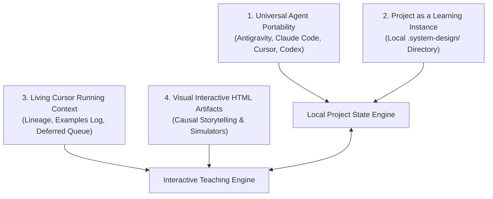

# System Design Studio

[](https://agentskills.io)
[](LICENSE)
[](README.md)
[](https://alph-a07.github.io/system-design-studio)
[](https://buymeacoffee.com/itsjeel01)

An open, portable, agent-agnostic systems architecture learning studio that runs directly inside your project repository under `.system-design/`. It teaches low-level component design, high-level distributed systems, infrastructure mechanisms, and mobile architecture across a canonical **50-cluster, 354-topic syllabus** through first-principles causal reasoning, Git-backed living state, and interactive visual simulators.

---

## The Problem with Conventional System Design Prep

Most systems architecture study fails for three mechanical reasons:

- **The Magic Box Trap**: Treating distributed components (Kafka, Redis, Cassandra) as pre-packaged answers rather than specific trade-off implementations constrained by hardware physics and algorithmic limits.
- **Context Amnesia**: AI chat sessions discard cognitive lineage on every context reset or model switch, forcing learners to re-explain prerequisites and suffering repeated stock analogies.
- **Fragile Cloud Dependencies**: Relying on external databases, hosted whiteboards, or proprietary SaaS tools that leak private code, break across air-gapped environments, and lack version control.

---

## Architectural Pillars



1. **Universal Agent Portability**: Zero proprietary runtime lock-in. 100% compliant with the open Agent Skills standard. Operates whether hosted in Google Antigravity, Claude Code, Cursor, Codex, or Gemini CLI.
2. **Project as a Learning Instance**: No external accounts, no cloud database locks, and no SaaS logins. Learning state resides entirely in a local `.system-design/` folder within your project, tracked by standard Git.
3. **Living Cursor State Engine (`CURSOR.md`)**: Replaces ephemeral LLM memory with deterministic, file-backed state. Tracks active focus, target depth, causal hardware anchors, domain examples (`examplesTaken`), and pending deferred questions (`deferredQueue`).
4. **Interactive HTML Lesson Artifacts (Strictly Artifact-First)**: New topics are delivered strictly inside standalone interactive HTML artifacts in `.system-design/lessons/`, complete with interactive JavaScript packet simulators, failure injection controls, SVG sequence traces, invariant matrices, and 5 customizable design themes (`settings.json`). Follow-up discussions happen directly inline in chat.

---

## The Project Learning Instance Model

Every learning workspace is a self-contained Git repository:

```text
my-project/
├── .git/
├── .system-design/
│   ├── manifest.json              # Canonical machine-readable state (schema v2.0)
│   ├── settings.json              # Theme & delivery preferences (5 visual styles)
│   ├── CURSOR.md                  # Living running context (brain of the instance)
│   ├── CURRICULUM.md              # Master 50-cluster syllabus with checkboxes
│   ├── DECISIONS.md               # Accepted Architecture Decision Records (ADRs)
│   └── lessons/                   # Standalone interactive HTML lesson artifacts
│       ├── topic-0.1-tcp-vs-udp.html
│       ├── topic-0.2-http-quic.html
│       └── ...
├── notes/                         # Learner personal markdown study notes
└── README.md
```

### Visual Artifact Themes & Settings (`settings.json`)

Choose your preferred visual aesthetic during initial setup or customize anytime in `.system-design/settings.json`:

| Theme ID | Aesthetic | Canvas | Key Character |
| :--- | :--- | :--- | :--- |
| `slate-clean` | **Modern Slate** *(Default)* | Dark | Deep slate background (`#0f172a`), vibrant blue accents, modern IDE feel. |
| `editorial-paper` | **Clean Editorial** | Light | High-readability warm off-white paper (`#fbfbfa`), charcoal text, ink accents. |
| `midnight-neon` | **Cyber Obsidian** | Dark | Pitch black obsidian (`#05070c`), electric cyan and mint neon highlights. |
| `nordic-frost` | **Nordic Frost** | Dark | Polar night cool slate (`#2e3440`), frosty teal accents, calm zero-eye-strain. |
| `warm-amber` | **Warm Amber** | Dark | Deep espresso stone (`#1c1917`), rich warm amber & copper accents for night reading. |

### Zero-Cloud Privacy Invariant
- Your code and notes never leave your local environment.
- Personal notes remain completely your own.
- The studio only inspects and updates the local `.system-design/` directory.

---

## Quickstart (Universal 1-Line Installer)

Install the skill for all your AI coding agents in a single command:

```bash
curl -fsSL https://raw.githubusercontent.com/alph-a07/system-design-studio/main/install.sh | bash
```

Or install for specific agents:
```bash
curl -fsSL https://raw.githubusercontent.com/alph-a07/system-design-studio/main/install.sh | bash -s -- --antigravity --claude --cursor --codex
```

---

## Universal 1-Line Updater (Preserves All Progress & Settings)

Keep System Design Studio and all your agent skills up to date with a single command:

```bash
curl -fsSL https://raw.githubusercontent.com/alph-a07/system-design-studio/main/update.sh | bash
```

### What Happens During Updates?
- **Zero Progress Loss**: Your `manifest.json`, `CURSOR.md`, `CURRICULUM.md`, `DECISIONS.md`, and `lessons/*.html` remain 100% intact.
- **Settings Merge Engine (`merge-settings.py`)**: Seamlessly incorporates newly released visual themes and configuration keys into your local `.system-design/settings.json` while **strictly preserving your active `artifactStyle`** and custom preferences.
- **In-Chat Update Prompts (`check-updates.py`)**: When an update is available on GitHub, your agent detects it and presents a non-intrusive alert directly in chat so you are never left on an outdated syllabus.

---

### Ready to Use in Any Chat
Open a chat in any supported AI agent and ask:
> *"Let's learn system design topic 0.1"*

On first use, the skill automatically initializes the hidden `.system-design/` workspace folder at your repository root to persist `CURSOR.md` and your learning progress across sessions.

Or run directly from a local clone:
```bash
bash skills/system-design-studio/scripts/init-learning-instance.sh "My Systems Architecture Journey"
```

### 2. Verify Instance Health
Run the automated diagnostic suite:

```bash
python3 skills/system-design-studio/scripts/verify-instance.py .system-design
```

### 3. Check Live Running Context
Inspect your active topic, progress percentage, examples log, and deferred questions:

```bash
python3 skills/system-design-studio/scripts/sync-status.py .system-design
```

### 4. Advance the Cursor Idempotently
When an agent or learner completes a topic after Socratic validation:

```bash
python3 skills/system-design-studio/scripts/advance-cursor.py \
  --complete-topic topic.0.1.tcp-vs-udp \
  --evidence "Learner traced socket buffer head-of-line blocking under packet loss" \
  --log-example-domain "Financial Ledger" \
  --log-example-scenario "Merchant payment idempotency key retry on TCP timeout" \
  --next-topic-id topic.0.1.http-1-1-vs-http-2-vs-http-3 \
  --next-action "Establish topic foundation for HTTP multiplexing"
```

---

## Installation Across AI Agent Platforms

Use the unified installer with platform flags to place the verified skill at each agent's standard path:

### Google Antigravity
Places skill in `~/.gemini/antigravity/skills/system-design-studio`:
```bash
curl -fsSL https://raw.githubusercontent.com/alph-a07/system-design-studio/main/install.sh | bash -s -- --antigravity
```

### Anthropic Claude Code
Places skill in `~/.claude/skills/system-design-studio`:
```bash
curl -fsSL https://raw.githubusercontent.com/alph-a07/system-design-studio/main/install.sh | bash -s -- --claude
```

### Cursor IDE
Places skill in `~/.cursor/skills/system-design-studio`:
```bash
curl -fsSL https://raw.githubusercontent.com/alph-a07/system-design-studio/main/install.sh | bash -s -- --cursor
```
And add steering rules to your project `.cursorrules`:
```bash
curl -fsSL https://raw.githubusercontent.com/alph-a07/system-design-studio/main/templates/.cursorrules >> .cursorrules
```

### OpenAI Codex
Places skill in `~/.codex/skills/system-design-studio`:
```bash
curl -fsSL https://raw.githubusercontent.com/alph-a07/system-design-studio/main/install.sh | bash -s -- --codex
```

---

## 5-Tier Canonical Syllabus (50 Clusters, 354 Topics)

| Tier | Focus Area | Clusters | Topics | Key Subject Matter |
| :--- | :--- | :--- | :--- | :--- |
| **Tier 0** | Foundations & Transport | 5 (0.1–0.5) | 37 | Socket mechanics, TLS 1.3 handshake latency, HTTP/2 multiplexing, QUIC packet formats, latency math. |
| **Tier 1** | LLD & Object Modeling | 14 (1.1–1.14) | 94 | Cache eviction (LRU/LFU), connection pool starvation, rate limiters (Token/Leaky Bucket), thread pools. |
| **Tier 2** | HLD & Distributed Infra | 18 (2.1–2.18) | 134 | Consistent hashing, write amplification (B-Tree vs LSM), Raft/Paxos quorums, event sourcing, CDC. |
| **Tier 3** | Mobile Systems & Offline | 11 (3.1–3.11) | 76 | Radio battery limits, mutation queues, optimistic UI reconciliation, SQLite caching, push delivery. |
| **Tier 4** | ADRs & System Defense | 2 (4.1–4.2) | 13 | Architectural Decision Records (ADRs), mock architecture defense, trade-off articulation, spaced review. |

Explore the complete interactive syllabus with browser-persisted progress tracking on the [Documentation Site](https://alph-a07.github.io/system-design-studio/curriculum.html).

---

## Bring Your Own Curriculum (BYO)

System Design Studio is completely curriculum-agnostic:

### 1. Import Custom Markdown Syllabi
Transform any internal team engineering syllabus or specialized roadmap into a fully indexed learning instance:

```bash
python3 skills/system-design-studio/scripts/import-curriculum.py \
  --input my-team-curriculum.md \
  --instance-dir .system-design \
  --title "Low-Latency Trading Architecture"
```

### 2. Configure a Custom Flagship Domain
Set `flagshipDomain` in `.system-design/CURSOR.md` (e.g. `Autonomous Vehicles`, `Fintech`, `Healthcare Imaging`). The tutor automatically anchors all subsequent mechanical traces and reality checks around your chosen vertical.

Read the complete customization guide in [`skills/system-design-studio/references/bring-your-own-curriculum.md`](skills/system-design-studio/references/bring-your-own-curriculum.md).

---

## Pedagogy: Kleppmann Meets Xu

System Design Studio bridges the two foundational schools of distributed systems education:

| Dimension | Martin Kleppmann (*Designing Data-Intensive Applications*) | Alex Xu (*System Design Interview* series) |
| :--- | :--- | :--- |
| **Primary Focus** | Bottom-up physical mechanics, storage engines, consensus, invariants. | Top-down scoping, quantitative estimation, component trade-off matrices. |
| **Mental Model** | Hardware latency hierarchy, write-ahead logs, 2PC, quorums, failure modes. | Peak QPS, storage footprint, 80/20 caching, high-level blueprints. |
| **Studio Integration** | The physical justification: why trivial software approaches break down. | The engineering structure: bounding problems and sizing hardware resources. |

---

## Documentation Site

The live GitHub Pages documentation site is available at:  
**[https://alph-a07.github.io/system-design-studio](https://alph-a07.github.io/system-design-studio)**

- **Interactive Syllabus Explorer**: Search and filter all 354 topics with local storage completion tracking.
- **Living Cursor Specification**: Technical manual of the project learning instance state machine.
- **CLI Reference**: Usage instructions for `init`, `advance`, `sync`, and `import-curriculum`.

---

## Support the Project

If you find System Design Studio valuable for mastering distributed systems and level-setting your architectural intuition, consider supporting its open-source development:

[](https://buymeacoffee.com/itsjeel01)

---

## License & Contributing

- **License**: MIT License ([LICENSE](LICENSE))
- **Contributing**: Please read [CONTRIBUTING.md](CONTRIBUTING.md) and [CODE_OF_CONDUCT.md](CODE_OF_CONDUCT.md).
- **Issues & Discussions**: Use our [Issue Templates](.github/ISSUE_TEMPLATE/) or start a GitHub Discussion.
