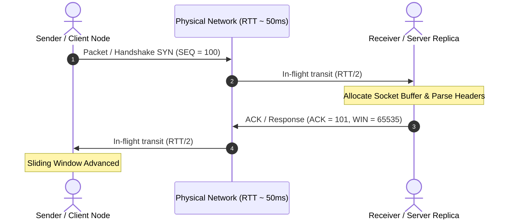

# TCP vs UDP: Reliability Mechanics

> **Hierarchy**: Tier ➔ Cluster  
> **Depth**: `[mechanics]` | **Format**: Clean Markdown (Zero-JS)

---

## 1. Fundamental Dilemma

Stop-and-wait vs blasting dilemma.

## 2. Mental Model

Postcard vs Registered Conveyor.

## 3. Internal Mechanics

Monotonic 32-bit sequence numbers.

### Protocol & State Machine Transition


### Hardware & Buffer State Trace
```text
+-----------------------------------------------------------------+
| INVARIANT: Speed of Light in Silica ~ 5 μs/km                  |
| TRANSIT:   Trans-Atlantic RTT ~ 70 ms | Local DC RTT ~ 0.5 ms   |
+-----------------------------------------------------------------+
| [Sender Socket Buffer] --------> [Kernel NIC Ring Buffer]       |
|          |                                  |                   |
|    (Write to FD)                    (Packet Serialization)      |
|          v                                  v                   |
| [TCP TX Queue: 64KB]             [Wire: IP/TCP Frame Header]   |
+-----------------------------------------------------------------+
```

## 4. Failure Realities

Packet drop freezes queue.

### Architectural Trade-Off Invariant Matrix
| Dimension | Primary Architectural Mechanism | Uncoordinated / Naive Alternative |
| :--- | :--- | :--- |
| **Latency Floor** | Predictable bound under normal conditions | Low initial RTT, catastrophic jitter on drop |
| **Coordination Cost** | Strict ordering & write amplification | Split-brain risk, out-of-order anomalies |
| **Failure Domain** | Bounded blast radius via timeouts & WAL | Cascading failure under thundering herd |

## 5. Verification

> [!IMPORTANT]
> **UNASSISTED SIGN-OFF CHALLENGE (DEFEND IN CHAT)**
> Defend WebRTC UDP choice.
>
> *Analyze the scenario above and defend your architectural recommendations cold in chat discussion to achieve topic sign-off.*
