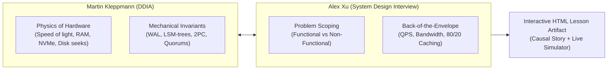

# 🏛️ System Design Studio

> **Connected Engineering & Project-Based System Design Learning for AI Agents**  
> *Universal agent compatibility: Google Antigravity, Claude Code, Cursor, Codex, and Gemini CLI.*

---

## 🎯 What is System Design Studio?

**System Design Studio** is an open, portable, agent-agnostic learning studio that runs directly inside your codebase or project repository. It transforms technical system design from passive memorization of architectural buzzwords (*"how to design Twitter"*) into **first-principles causal reasoning**, **mechanical closure**, and **interactive visual learning**.

### Why Most System Design Prep Fails:
* **The "Magic Box" Trap**: Treating components (Kafka, Redis, Cassandra) as magic solutions rather than trade-off implementations of physical and algorithmic limits.
* **Cognitive Fragmentation**: Tutors jumping between random, disconnected examples every turn without causal continuity.
* **Fragile Cloud Dependencies**: Fragile integrations with external database tools (Notion) or drawing boards that break across environments, leak codebases, and fail offline.

### The System Design Studio Difference:
1. **Universal Agent Portability**: 100% compliant with the open Agent Skills standard. Operates identically whether running in Antigravity, Claude Code, Cursor, Codex, or Gemini CLI.
2. **Project as a Learning Instance**: No external accounts, no cloud database locks, no Notion API keys, and no drawing board logins. The learning state lives in a local `.system-design/` folder in your project, version-controlled by standard Git.
3. **Cursor & Curriculum as the Sole Shared Context**:
   - **`CURRICULUM.md`**: Master 50-cluster syllabus with 354 topics and actionable tick-off rules.
   - **`CURSOR.md`**: The living operational brain tracking active focus, target depth, causal lineage (backward anchor & forward hook), domain examples registry (`examplesTaken`), and pending deferred questions (`deferredQueue`).
4. **Interactive HTML Lesson Artifacts**: Lessons are delivered not as flat, dry bullet points, but as **carefully crafted, beautifully styled, interactive HTML artifacts** with embedded JavaScript simulators, SVG sequence traces, invariant matrices, and active reality checks.

---

## 🏗️ The Project-as-a-Learning-Instance Model

Every learning workspace is a self-contained Git repository:

```text
my-system-design-journey/
├── .git/
├── .system-design/
│   ├── manifest.json              # Canonical machine-readable state (schema v2.0)
│   ├── CURSOR.md                  # Living running context (brain of the instance)
│   ├── CURRICULUM.md              # Living 50-cluster syllabus with checkboxes
│   ├── DECISIONS.md               # Accepted Architecture Decision Records (ADRs)
│   └── lessons/                   # Standalone interactive HTML lesson artifacts
│       ├── topic-0.1-tcp-vs-udp.html
│       ├── topic-0.2-http-quic.html
│       └── ...
├── notes/                         # Learner's personal study notes (100% private)
└── README.md
```

### Zero-Cloud Privacy Invariant
* **Your code never leaves your machine.**
* **Personal notes remain your own.**
* The studio only reads and updates `.system-design/` within your current project root.

---

## ⚡ 1-Minute Quickstart

### 1. Initialize a Learning Instance
Run the scaffolding script inside any new or existing project directory:

```bash
~/.agents/skills/system-design-studio/scripts/init-learning-instance.sh "My System Design Mastery"
```

This scaffolds `.system-design/` with the complete 50-cluster curriculum, template cursor, and manifest at pristine 0% state.

### 2. Verify Instance Health
Run the automated diagnostic and verification suite:

```bash
python3 ~/.agents/skills/system-design-studio/scripts/verify-instance.py .system-design
```

### 3. Check Live Running Context
Inspect your active topic, progress percentage, examples log, and deferred questions:

```bash
python3 ~/.agents/skills/system-design-studio/scripts/sync-status.py .system-design
```

### 4. Advance the Cursor Idempotently
When an agent or learner completes a topic:

```bash
python3 ~/.agents/skills/system-design-studio/scripts/advance-cursor.py \
  --complete-topic topic.0.1.tcp-vs-udp \
  --evidence "Learner traced TCP sequence numbering and receive window bufferbloat" \
  --log-example-domain "Financial Ledger" \
  --log-example-scenario "Merchant payment idempotency key retry on TCP timeout" \
  --next-topic-id topic.0.1.http-1-1-vs-http-2-vs-http-3 \
  --next-action "Establish topic foundation for HTTP/1.1 vs HTTP/2 vs HTTP/3 (HOL blocking)" \
  --lesson-artifact .system-design/lessons/topic-0.1-tcp-vs-udp.html
```

---

## 🧠 Pedagogy Grounded in Longevity: Kleppmann Meets Xu

System Design Studio bridges the two foundational schools of distributed architecture:



### The 6-Part Topic Foundation
Every topic begins with an unshakeable foundation before deep diving into packet traces or algorithms:
1. **Physical Problem & Motivation**: What physical limit forces this mechanism into existence?
2. **System Placement**: Where does this component sit in the architectural stack?
3. **Design Relevance**: Which trade-offs (latency, durability, consistency, cost) depend on it?
4. **Prerequisites & Vocabulary**: Define necessary terms immediately; eliminate unexplained jargon.
5. **Mental Model**: Intuitive visual or mechanical model of the moving parts.
6. **Learning Bridge**: Connect to prior topics and state what is deferred.

---

## 🎨 Interactive HTML Lesson Artifacts

Instead of walls of dry bullet points, lessons are generated as standalone, responsive HTML files:
* **Tailwind CSS Styling**: Clean, modern dark/light system theme support.
* **Embedded Simulators**: Interactive JavaScript controls allowing the learner to step through packet transmissions, inject network drops, test head-of-line blocking, and observe buffer states in real time.
* **Workload Contrasts**: Direct side-by-side comparison of opposing real-world profiles (e.g., Financial Ledger vs High-Throughput Telemetry).
* **Invariant Matrices**: Rigorous tables detailing guaranteed invariants vs non-guarantees.
* **Engineering Reality Checks**: Practical production failure scenarios with revealable root-cause breakdowns.

---

## 🤖 Multi-Agent Compatibility Guide

| Agent Platform | Integration Mechanism | HTML Rendering | State Retention |
| :--- | :--- | :--- | :--- |
| **Google Antigravity** | Native Skill / Plugin | Live Side Pane (`UserFacing: true`) | `.system-design/` + Git |
| **Claude Code** | Native Skill Folder | Standalone HTML browser view | `.system-design/` + Git |
| **Cursor** | Workspace Skill / Rule | Built-in Editor Preview | `.system-design/` + Git |
| **Codex / OpenAI** | CLI / Bash Tool | Standalone HTML browser view | `.system-design/` + Git |
| **Gemini CLI** | Skill Directory | Terminal link / Local Browser | `.system-design/` + Git |

---

## 📁 Repository & Skill Structure

```text
skills/system-design-studio/
├── SKILL.md                          # Main skill instructions (open Agent Skills standard)
├── README.md                         # Public documentation and quickstart guide
├── references/                       # Deep technical specifications
│   ├── first-principles-pedagogy.md  # Synthesis of Kleppmann & Alex Xu
│   ├── interactive-html-artifacts.md # HTML artifact design guidelines
│   ├── project-learning-instance.md  # Local project architecture contract
│   ├── running-context-engine.md     # Examples registry & deferred queue spec
│   ├── context-manifest-spec.md      # v2.0 JSON manifest schema
│   ├── interaction-contract.md       # Pedagogical pacing & checkpoint rules
│   ├── connected-closure-method.md   # 7-step causal closure checklist
│   └── fresh-fictional-problems.md   # Safe fictional scenario generator
├── resources/                        # Reusable templates & canonical curricula
│   ├── CURRICULUM-template.md        # Canonical 50-cluster syllabus (354 topics)
│   ├── CURSOR-template.md            # Living cursor operational template
│   ├── manifest-template.json        # Pristine 0% state manifest
│   └── lesson-template.html          # Interactive HTML lesson starter template
└── scripts/                          # Deterministic, zero-dependency CLI tools
    ├── init-learning-instance.sh     # Instance scaffolding script
    ├── advance-cursor.py             # Idempotent state transition engine
    ├── sync-status.py                # Diagnostic reporting CLI
    ├── render-lesson.py              # Interactive HTML lesson compiler
    └── verify-instance.py            # Automated health & parity verification
```

---

## 📜 License

MIT License. Built for the open developer and AI agent community.
