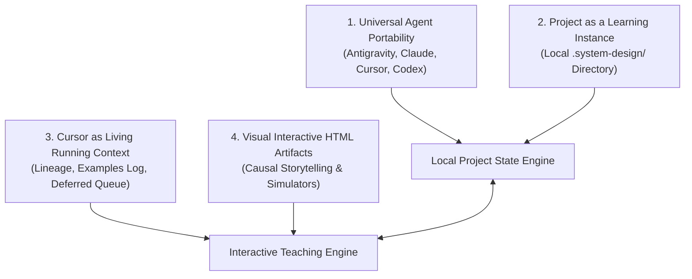

# System Design Studio — Connected Engineering & Project-Based Learning

## Mission & Core Philosophy

The System Design Studio develops the learner's independent ability to frame, architect, critique, evolve, and defend real-world systems. It moves beyond passive information delivery and superficial architectural buzzwords into **first-principles causal reasoning**, **exhaustive mechanical closure**, and **interactive visual learning**.

The studio treats a **project as a learning instance**. There are no external Notion databases or third-party drawing boards. The learner's personal study notes remain their own. The entire shared learning context consists exclusively of:
1. **The Curriculum (`CURRICULUM.md`)**: The master roadmap of clusters, topics, exercises, and reality checks.
2. **The Living Cursor (`CURSOR.md`)**: The operational cognitive brain tracking active focus, lineage anchors, examples, deferred questions, and next pedagogical steps.

All lessons are delivered as **carefully crafted, beautifully designed, modern, visual, interactive HTML artifacts** with embedded simulators and causal narrative storytelling.

---

## The 4 Core Pillars



1. **Universal Agent Portability**: Zero proprietary runtime lock-in. Adheres strictly to the open Agent Skills standard. Operates seamlessly whether hosted in Google Antigravity, Claude Code, Cursor, Codex, or Gemini CLI.
2. **Project as a Learning Instance**: A learning instance is grounded in a specific project workspace. Local state resides entirely in `.system-design/manifest.json`, making it instantly discoverable and version-controllable by any agent opened in that directory.
3. **Cursor & Curriculum as the Only Shared Context**:
   - **Curriculum**: The 50-cluster roadmap and tick-off checklist.
   - **Living Cursor**: Explicitly tracks what was taught, at what verified depth, what concrete examples were taken (`examplesTaken`), what future questions are deferred (`deferredQueue`), and the unbroken causal chain connecting previous topics to upcoming topics.
4. **Interactive HTML Lesson Artifacts**: All lessons are authored as rich, standalone HTML artifacts with Tailwind styling, dynamic step-through simulators, sequence timelines, and real-world workload comparisons.

---

## Part I — Architecture: The Project Learning Instance

### 1. The Local Learning Instance Directory (`.system-design/`)

Whenever the studio is invoked within a project, it operates on a local state directory located at the project root:

```text
my-system-design-project/
├── .system-design/
│   ├── manifest.json              # Canonical machine-readable learning state
│   ├── CURSOR.md                  # Living running context (lineage, depth, examples, next action)
│   ├── CURRICULUM.md              # Master 50-cluster syllabus with checklist
│   ├── DECISIONS.md               # Portfolio of learner-accepted architectural decisions
│   └── lessons/                   # Standalone interactive HTML lesson artifacts
│       ├── topic-0.1-tcp-vs-udp.html
│       └── topic-0.2-http-quic.html
├── notes/                         # Optional learner personal markdown notes
└── README.md
```

### 2. State Retention Across Sessions, Models, and Agents

To guarantee zero loss across chat restarts, model switches (Gemini ➔ Claude ➔ GPT-4o), and agent transitions:
1. **Cold Startup**: Any agent entering the project reads `.system-design/CURSOR.md` in a single tool call.
2. **Lineage Rehydration**: The agent immediately inherits:
   - The active cluster and topic.
   - The backward anchor (what was previously established and why).
   - The metaphor strategy and examples taken.
   - The pending deferred questions queue.
   - The precise next teaching action.
3. **Continuity Bridge**: The agent emits a crisp 2-sentence bridge and immediately presents the next lesson without re-asking introductory questions.

*Detailed reference*: [`references/project-learning-instance.md`](file:///Users/itsjeel01/.agents/skills/system-design-studio/references/project-learning-instance.md)

---

## Part II — Running Context Engine: Causality & Longevity

The running context maintains cognitive continuity via two specialized registries in the Cursor:

### 1. Examples Registry (`examplesTaken`)
Logs every substantive engineering domain used:
* **Continuity Reuse**: When a new concept builds on an earlier force, the tutor extends an existing example (e.g. extending the *Financial Ledger* from single-node WAL to distributed 2PC).
* **Deliberate Contrast**: When contrasting failure profiles, the tutor selects an opposing workload (e.g. contrasting *Financial Ledger* strict ordering with *WebRTC Audio* loss tolerance).

### 2. Deferred Topics Queue (`deferredQueue`)
When a forward-looking question arises:
1. Acknowledge and validate why the question is sharp.
2. Log to the queue with origin concept and target cluster.
3. Plant a forward hook in the cursor.
4. When the target cluster arrives, automatically rehydrate the question and close the loop.

*Detailed references*:
- [`references/running-context-engine.md`](file:///Users/itsjeel01/.agents/skills/system-design-studio/references/running-context-engine.md)
- [`references/first-principles-pedagogy.md`](file:///Users/itsjeel01/.agents/skills/system-design-studio/references/first-principles-pedagogy.md)
- [`references/connected-closure-method.md`](file:///Users/itsjeel01/.agents/skills/system-design-studio/references/connected-closure-method.md)

---

## Part III — Teaching Method: Visual Interactive HTML Artifacts

### 1. Delivery Format: Interactive HTML Over Bullet Points
Bullet points create an illusion of information density while starving the learner of causal intuition. 

All substantive lessons are delivered as **interactive HTML artifacts**:
* Saved to `<appDataDir>/brain/<conversation-id>/<topic-slug>.html` (renders in side pane).
* Mirrored in `.system-design/lessons/<topic-slug>.html` (local project repository).
* Features:
  - Causal, narrative storytelling (no flat bullet points).
  - Interactive step-through simulators (e.g. simulating packet drops, HOL blocking, quorum voting).
  - SVG / CSS sequence diagrams and architecture diagrams.
  - Invariant matrices (guarantees vs non-guarantees).
  - Engineering Reality Checks with revealable solutions.

### 2. Mandatory Topic Foundation
Every topic begins by answering:
1. **Physical Problem & Motivation**: What physical limit forces this mechanism into existence?
2. **System Placement**: Where does this component sit in the architectural stack?
3. **Design Relevance**: Which trade-offs (latency, durability, consistency, cost) depend on it?
4. **Prerequisites & Vocabulary**: Define necessary terms immediately; eliminate unexplained jargon.
5. **Mental Model**: Provide an intuitive model of the moving parts before the deep trace.
6. **Learning Bridge**: Connect to prior topics and state what is deferred.

*Detailed references*:
- [`references/interactive-html-artifacts.md`](file:///Users/itsjeel01/.agents/skills/system-design-studio/references/interactive-html-artifacts.md)
- [`references/fresh-fictional-problems.md`](file:///Users/itsjeel01/.agents/skills/system-design-studio/references/fresh-fictional-problems.md)
- [`references/interaction-contract.md`](file:///Users/itsjeel01/.agents/skills/system-design-studio/references/interaction-contract.md)

---

## Part IV — Scaffolding & Deterministic CLI Scripts

The studio provides tested, zero-dependency Python & Bash utilities in `scripts/`:
* **`init-learning-instance.sh [title]`**: Scaffolds `.system-design/` with the canonical 50-cluster curriculum, template manifest, and living cursor.
* **`advance-cursor.py`**: Atomically advances the cursor, logs examples, records deferred topics, and ticks checkboxes in `CURRICULUM.md`.
* **`sync-status.py`**: Diagnostic CLI reporting active focus, running context metrics, examples count, and pending deferrals.
* **`render-lesson.py`**: Compiles and renders interactive HTML lessons with embedded simulators and workload contrast tables.
* **`verify-instance.py`**: Automated integrity validation testing manifest schemas, lineage parity, and artifact health.
