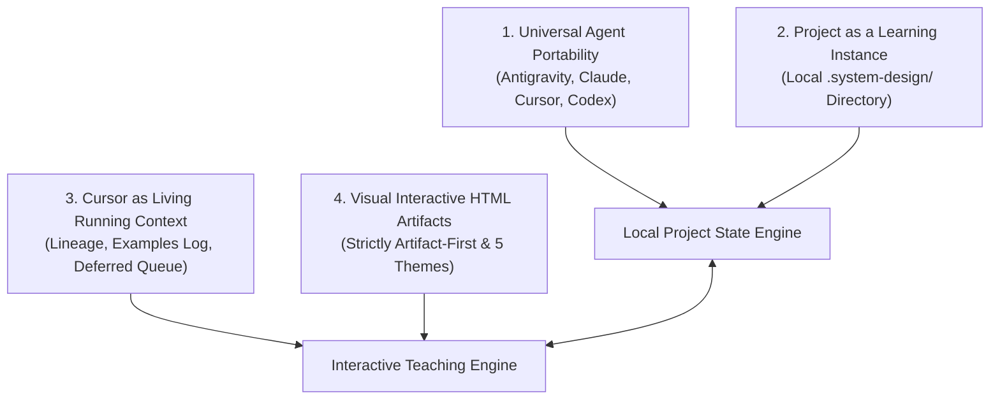
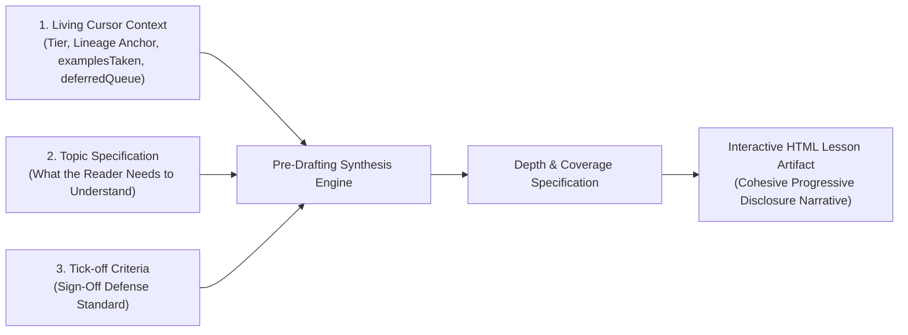

# System Design Studio — Connected Engineering & Project-Based Learning

## Mission & Core Philosophy

The System Design Studio develops the learner's independent ability to frame, architect, critique, evolve, and defend real-world systems. It moves beyond passive information delivery and superficial architectural buzzwords into **first-principles causal reasoning**, **exhaustive mechanical closure**, and **interactive visual learning**.

The studio treats a **project as a learning instance**. There are no external Notion databases or third-party drawing boards. The learner's personal study notes remain their own. The entire shared learning context consists exclusively of:
1. **The Curriculum (`CURRICULUM.md`)**: The master roadmap of clusters, topics, exercises, and reality checks.
2. **The Living Cursor (`CURSOR.md`)**: The operational cognitive brain tracking active focus, lineage anchors, examples, deferred questions, and next pedagogical steps.
3. **The Studio Settings (`settings.json`)**: Configurable instance preferences including visual artifact styles and interaction modes.

All lessons are delivered as **carefully crafted, beautifully designed, modern, visual, interactive HTML artifacts** with embedded simulators and causal narrative storytelling.

---

## The 4 Core Pillars



1. **Universal Agent Portability**: Zero proprietary runtime lock-in. Adheres strictly to the open Agent Skills standard. Operates seamlessly whether hosted in Google Antigravity, Claude Code, Cursor, Codex, or Gemini CLI.
2. **Project as a Learning Instance**: A learning instance is grounded in a specific project workspace. Local state resides entirely in `.system-design/manifest.json` and `.system-design/settings.json`, making it instantly discoverable and version-controllable by any agent opened in that directory.
3. **Cursor & Curriculum as the Only Shared Context**:
   - **Curriculum**: The 50-cluster roadmap and tick-off checklist.
   - **Living Cursor**: Explicitly tracks what was taught, at what verified depth, what concrete examples were taken (`examplesTaken`), what future questions are deferred (`deferredQueue`), and the unbroken causal chain connecting previous topics to upcoming topics.
4. **Interactive HTML Lesson Artifacts**: All lessons are authored as rich, standalone HTML artifacts with dynamic step-through simulators, sequence timelines, real-world workload comparisons, and 5 customizable design themes.

---

## Automatic Workspace Bootstrap & Style Selection

When the user asks to learn or study system design in any workspace or project:

1. **Check for `.system-design/` Directory**:
   - Inspect if `.system-design/CURSOR.md` and `.system-design/settings.json` exist in the current project root.
2. **First Use Auto-Initialization**:
   - If `.system-design/` does **not** exist yet, run the bundled initialization script to scaffold it:
     ```bash
     bash <skill-dir>/scripts/init-learning-instance.sh "My System Design Journey"
     ```
     *(or execute the equivalent logic to create `manifest.json`, `CURSOR.md`, `CURRICULUM.md`, `settings.json`, `DECISIONS.md`, and `lessons/`)*.
   - If in a git repository with other teammates, add `.system-design/` to `.gitignore` if requested.
3. **Initial Style Preference Prompt**:
   - On initial setup (or when `settings.json` has not yet been confirmed by the user), prompt the learner to choose their preferred visual artifact style from the **5 Studio Themes**:
     - `1. slate-clean` — **Modern Slate (Dark Tech)** `[Default]`: Deep slate background with vibrant blue/indigo accents. Modern developer IDE aesthetic.
     - `2. editorial-paper` — **Clean Editorial (Warm Light)**: High-readability warm off-white canvas with sharp typography and ink/coral accents.
     - `3. midnight-neon` — **Cyber Obsidian (High Contrast)**: Pitch black obsidian canvas with electric cyan and mint neon highlights.
     - `4. nordic-frost` — **Nordic Frost (Polar Calm)**: Arctic cool dark palette with frosty teal and snow-storm text for calm, focused study.
     - `5. warm-amber` — **Warm Amber (Espresso Glow)**: Rich espresso and sepia tones with warm amber/copper accents designed for low eye fatigue.
   - Record the chosen style in `.system-design/settings.json` under `"artifactStyle"`. Users can change this setting at any time to immediately restyle subsequent lesson artifacts.
4. **Subsequent Chats & Turns**:
   - Always read `.system-design/CURSOR.md` and `.system-design/settings.json` at the start of each topic to recover living state, recent examples, active causal anchors, and styling preferences.
5. **Periodic Update Check & Preference Preservation**:
   - Run `python3 <skill-dir>/scripts/check-updates.py` during session startup or diagnostics.
   - If a new version is detected, display a non-intrusive alert:
     > 🔔 **Update Available**: System Design Studio vX.Y.Z is available (current: vA.B.C).  
     > Run: `curl -fsSL https://raw.githubusercontent.com/alph-a07/system-design-studio/main/update.sh | bash`  
     > *(Your progress in `manifest.json`, `CURSOR.md`, and custom theme in `settings.json` are automatically preserved via `merge-settings.py`)*.

---

## Part I — Architecture: The Project Learning Instance

### 1. The Local Learning Instance Directory (`.system-design/`)

Whenever the studio is invoked within a project, it operates on a local state directory located at the project root:

```text
my-system-design-project/
├── .system-design/
│   ├── manifest.json              # Canonical machine-readable learning state
│   ├── settings.json              # Visual themes, directory paths, and teaching mode preferences
│   ├── CURSOR.md                  # Living running context (lineage, depth, examples, next action)
│   ├── CURRICULUM.md              # Master 50-cluster syllabus with checklist
│   ├── DECISIONS.md               # Portfolio of learner-accepted architectural decisions
│   └── lessons/                   # Standalone interactive HTML lesson artifacts
│       ├── topic-0.1-tcp-vs-udp.html
│       └── topic-0.2-http-quic.html
├── notes/                         # Optional learner personal markdown notes
└── README.md
```

#### Directory Preferences in `settings.json`
Learners can customize where the cursor and lessons are stored by modifying `paths` in `.system-design/settings.json`:
```json
{
  "$schemaVersion": "3.0",
  "artifactStyle": "slate-clean",
  "paths": {
    "instanceDir": ".system-design",
    "cursorDir": ".system-design",
    "lessonsDir": ".system-design/lessons"
  }
}
```
- **`cursorDir`**: Custom directory to persist and read `CURSOR.md`.
- **`lessonsDir`**: Custom directory where HTML lesson artifacts are generated and indexed.
- **`instanceDir`**: Target instance state directory for `manifest.json`, `CURRICULUM.md`, and updates.

All scripts (`render-lesson.py`, `advance-cursor.py`, `verify-instance.py`, `sync-status.py`, `update.sh`) automatically detect and respect these paths.

### 2. State Retention Across Sessions, Models, and Agents

To guarantee zero loss across chat restarts, model switches (Gemini ➔ Claude ➔ GPT-4o), and agent transitions:
1. **Cold Startup**: Any agent entering the project reads `.system-design/CURSOR.md` and `.system-design/settings.json` in a single tool call.
2. **Lineage Rehydration**: The agent immediately inherits:
   - The active cluster and topic.
   - The backward anchor (what was previously established and why).
   - The metaphor strategy and examples taken.
   - The pending deferred questions queue.
   - The chosen visual artifact style.
   - The precise next teaching action.
3. **Continuity Bridge**: The agent emits a crisp 2-sentence bridge and immediately presents the next lesson without re-asking introductory questions.

---

## Part II — Running Context Engine: Causality & Longevity

The running context maintains cognitive continuity via two specialized registries in the Cursor:

### 1. Examples Registry (`examplesTaken`)
Logs every substantive engineering domain used:
* **Continuity Reuse**: When a new concept builds on an earlier force, the tutor extends an existing example (e.g. extending the *Financial Ledger* from single-node WAL to distributed 2PC).
* **Deliberate Contrast**: When contrasting failure profiles, the tutor selects an opposing workload (e.g. contrasting *Financial Ledger* strict ordering with *WebRTC Audio* loss tolerance).

### 2. Deferred Topics Queue (`deferredQueue`)
When a forward-looking question arises:
1. Acknowledge and validate why the question is sharp.
2. Log to the queue with origin concept and target cluster.
3. Plant a forward hook in the cursor.
4. When the target cluster arrives, automatically rehydrate the question and close the loop.

### 3. Causal Anchors (`causalAnchors`)
Records physical invariants and hardware bounds verified during signed-off topics (e.g., speed of light in silica at ~5 μs/km, cold TLS 1.3 handshakes, WAL fsync latencies).
* **Source & Verification Rule**: Never populated with speculative claims. Only physical constants, hardware constraints, or mathematically verified invariant bounds established and tested during sign-off gates are admitted, ensuring all subsequent lessons reason from verified physical ground truth.

---

## Part III — Teaching Delivery Protocol: Strictly Artifact-First & Sign-Off Gated

### 1. Topic Verbatim Anatomy: Outcome Specification vs Sign-Off Gate

Every topic checklist item in `CURRICULUM.md` follows a strict three-part verbatim structure:

```text
- [ ] <Topic Title> — <What Reader Needs to Understand Specification> — *Tick off when: <Tick-off Criteria>*
```

#### Strict Separation of Concerns:
1. **`<Topic Title>`**:
   - The formal technical identifier of the component, protocol, or architectural mechanism.
2. **`What Reader Needs to Understand Specification` (Everything BEFORE `— *Tick off when:*`)**:
   - Specifies the **target invariant outcome and conceptual comprehension** the reader must walk away with.
   - **CRITICAL**: This is **NOT what needs to be taught directly or recited as a lecture**. It defines the target destination of understanding, not the pedagogical journey.
3. **`Tick-off Criteria` (Everything AFTER `— *Tick off when:*`)**:
   - **CRITICAL**: Tick-off criteria is **STRICTLY NOT part of the teaching scope**.
   - It is strictly the **Final Sign-off Verification Gate**.
   - The lesson artifact and explanation must **NEVER** answer or reveal the tick-off scenario. There are no reveal buttons, solution accordions, or pre-baked answers in the lesson artifact.
   - Instead, the artifact leaves the learner with a **suitable, relevant engineering scenario WITHOUT AN ANSWER**.
   - The sign-off status (marking the checkbox in `CURRICULUM.md`, logging evidence in `manifest.json`, and advancing `CURSOR.md`) is evaluated **strictly and exclusively based on the reader's independent answer and defense during chat discussion**.

---

### 2. Pre-Drafting Synthesis Engine: Determining "What Needs to Be Taught"

Before drafting any lesson artifact or explaining a topic, the agent MUST evaluate and gauge **what needs to be taught** by synthesizing three distinct inputs:



1. **Living Cursor Context**:
   - **Active Tier & Cluster Depth Target**: (`[concept]`, `[mechanics]`, `[contrast]`, `[pattern]`, `[trap]`).
   - **Connected Lineage (Backward Anchor)**: What physical facts, hardware constraints, protocols, or storage invariants were already grounded in previous topics? Never re-explain from zero what was already verified.
   - **Examples Registry (`examplesTaken`)**: What concrete domain metaphors are established? Extend existing domains (e.g. *Financial Ledger*) where continuity helps, or deliberately contrast with an opposing workload (e.g. *WebRTC Audio*).
   - **Deferred Queue (`deferredQueue`)**: Are there parked forward questions that this topic naturally resolves?
2. **Topic's "What Reader Needs to Understand" Specification**:
   - The core mental models, physical constraints, failure modes, and invariant boundaries that must be grasped.
3. **Tick-off Criteria**:
   - What unprompted explanation, quantitative derivation, or failure analysis the reader must be able to deliver cold.

#### Determining Depth & Coverage:
By combining (1) Cursor Context, (2) Outcome Specification, and (3) Tick-off Criteria, the agent deterministically gauges:
- What underlying physical constraints / hardware bounds must be grounded first.
- What 3 to 5 interrelated causal mechanisms must be traced step-by-step.
- What interactive simulation scenario will make the reader *experience* the failure mode.
- What contrasting workloads expose the non-negotiable architectural trade-off.
- What realistic, unassisted scenario will be left as the final sign-off challenge without giving away the answer.

---

### 3. The Core Rule: Strictly HTML Artifact-Based Teaching For New Topics

> [!IMPORTANT]
> **NO HYBRID LECTURE DUPLICATION IN CHAT & NO PRE-BAKED SOLUTION LEAKS.**
> Delivering a long markdown explanation in chat while producing an HTML artifact is strictly forbidden. Leaking or embedding the answer to the sign-off scenario inside the artifact is strictly forbidden.

- **Topic Entry (First Turn on a Topic)**:
  - The comprehensive lesson is delivered **strictly inside the standalone interactive HTML artifact**, structured as **one continuous, cohesive discussion with progressive disclosure**:
    - **No repetitive coverage silos**: No "brief overview" followed by "foundation cards" followed by "deep explanations" and a "summary table". Concepts are introduced only when the narrative naturally requires them.
    - **No artificial section indexing**: Sections are not indexed by category names or numbers (e.g. no "01 Foundation"). Sections use topic-driven narrative headings that tell the ongoing engineering story.
    - **Embedded interactive components**: Interactive simulators or state machines have no dedicated siloed section; they are embedded inline wherever the mechanism is explained.
    - **The 5 Narrative Stages**:
      1. *Background Context & The Forcing Problem*: What broke in the absence of the active topic? Exhaustive closure on WHY (and optional WHEN). A concrete dilemma introduced here continues throughout.
      2. *The Active Topic & Its Landscape*: WHAT the mechanism is and WHERE it sits in the architectural stack (assumed new unless cursor states otherwise). Exhaustive closure on WHAT and WHERE.
      3. *Internal Mechanics & Causality*: HOW it works, WHY it works that way, and why alternatives fail. Digestible grasp with inline interactive simulator.
      4. *Mental Model Synthesis & Production Grounding*: Bundles prior mechanics into a sticky mental model and correlates with real-world production workloads.
      5. *Contextual Sign-Off Verification Gate*: Leaves the reader with one or more contextual engineering scenarios without answers to defend in chat.
  - **Artifact Storage Locations (Universal & Portable)**:
    1. **Primary (Universal)**: Save directly to `.system-design/lessons/<topic-slug>.html` (or configured `paths.lessonsDir`). This is Git-tracked and works universally across all agents (Claude Code, Cursor, Codex, and Antigravity).
    2. **Side-Pane Staging (Antigravity-Specific)**: IF AND ONLY IF running inside Antigravity (where an Artifact Directory Path `<appDataDir>/brain/<conversation-id>` is provided in context), also stage a copy to `<appDataDir>/brain/<conversation-id>/<topic-slug>.html` with `UserFacing: true` so the side-pane viewer renders it immediately. Do not attempt this path in Claude Code, Cursor, or Codex.
  - The in-chat response must be **strictly a concise delivery bridge** (5–12 lines):
    1. Announce the active topic, cluster code, and tier.
    2. Provide a clickable link to the generated artifact.
    3. State the core physical force or architectural problem in 2–3 sentences.
    4. Direct the learner to open the artifact in the side pane to interact with the simulator.
    5. Present the final sign-off scenario prompt to invite the learner's analysis and discussion when ready.

- **Same-Topic Follow-ups (Subsequent Turns on the Same Topic)**:
  - Once the topic artifact has been delivered, all follow-up discussions, Q&A, drill-downs, code traces, trade-off debates, and evaluation of the sign-off scenario happen **directly inline within the chat conversation**.
  - Do NOT generate another HTML artifact for follow-up conversational turns on the same topic.
  - The conversation flows naturally in chat: the learner analyzes the scenario, asks questions, or proposes architectural solutions; the tutor evaluates reasoning, stress-tests edge cases, and provides causal closure directly in chat.

- **Sign-Off Evaluation & Advancing to Next Topic**:
  - The tutor evaluates the learner's independent response against the tick-off criteria:
    - **Demonstrated Mastery**: If the learner correctly identifies the causal invariants, failure modes, and costs without prompting, the tutor validates their reasoning, logs verified evidence in `manifest.json`, ticks off the topic in `CURRICULUM.md`, and advances the cursor via `advance-cursor.py`.
    - **Partial / Shaky Understanding**: The tutor provides targeted causal repair directly in chat and tests with a related failure scenario until the invariant is solid. The checkbox remains unchecked until mastery is demonstrated.
  - Only upon successful sign-off does the tutor advance to the **next topic**, triggering the artifact-first rule for the next topic's foundation.

---

### 4. The 5 Visual Artifact Themes & `settings.json`

Every rendered HTML artifact adopts the theme configured in `.system-design/settings.json`:

| Style ID | Theme Name | Canvas Mode | Aesthetic & Character |
| :--- | :--- | :--- | :--- |
| `slate-clean` | **Modern Slate** *(Default)* | Dark | Deep slate background (`#0f172a`), vibrant blue accents, modern IDE feel. |
| `editorial-paper` | **Clean Editorial** | Light | Warm off-white paper (`#fbfbfa`), charcoal typography, crisp ink/indigo accents. |
| `midnight-neon` | **Cyber Obsidian** | Dark | Pitch black obsidian (`#05070c`), electric cyan and mint neon highlights. |
| `nordic-frost` | **Nordic Frost** | Dark | Polar night cool slate (`#2e3440`), frosty teal accents, calm zero-eye-strain. |
| `warm-amber` | **Warm Amber** | Dark | Deep espresso stone (`#1c1917`), rich warm amber & copper accents for night reading. |

The styling engine injects CSS custom properties (`:root`) into each generated artifact. When the learner switches styles in `settings.json`, all subsequent lessons immediately render in the chosen aesthetic.

---

### 5. Progressive Disclosure Flow Inside the Artifact
Rather than an abstract upfront metadata dump, the lesson unfolds through progressive disclosure:
1. **The Forcing Dilemma (WHYs & WHENs)**: Grounded in physical constraints and what broke before this mechanism existed. Sets a concrete dilemma that persists throughout.
2. **Core Abstraction & Placement (WHATs & WHEREs)**: Assumed new unless established; defines the entity and its exact boundary in the stack.
3. **Internal Mechanics & Causality (HOWs & WHYs of HOWs)**: Step-by-step causal trace, why alternative designs fail, and tactile inline simulation.
4. **Mental Model & Production Grounding**: Synthesis into a lasting mental model with contrasting real-world workloads and an invariant matrix.
5. **Contextual Sign-Off Gate**: A bounded failure scenario testing the criteria without pre-baked answers.

---

## Part IV — Scaffolding & Deterministic CLI Scripts

The studio provides tested, zero-dependency Python & Bash utilities in `scripts/`:
* **`init-learning-instance.sh [title]`**: Scaffolds `.system-design/` with curriculum, manifest, living cursor, and `settings.json`.
* **`update.sh`**: Updates installed agent skills and merges local `.system-design/settings.json` safely.
* **`check-updates.py`**: Cached semver version check against GitHub releases with non-intrusive alert prompts.
* **`merge-settings.py`**: Merges new settings keys and themes into existing `settings.json` without overwriting user preferences.
* **`advance-cursor.py`**: Atomically advances cursor, logs examples, records deferred topics, and ticks checkboxes in `CURRICULUM.md`.
* **`sync-status.py`**: Diagnostic CLI reporting active focus, running context, active theme, update status, and pending deferrals.
* **`render-lesson.py`**: Compiles and renders interactive HTML lessons with theme stylesheets and embedded simulators.
* **`verify-instance.py`**: Automated integrity validation testing manifest schemas, lineage parity, settings schemas, and artifact health.
