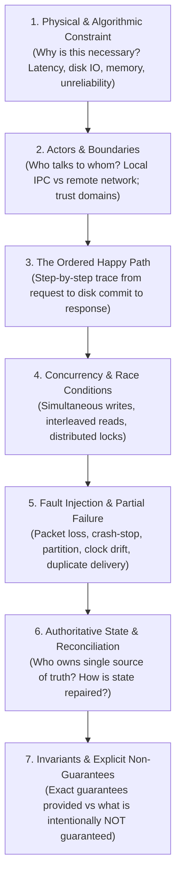
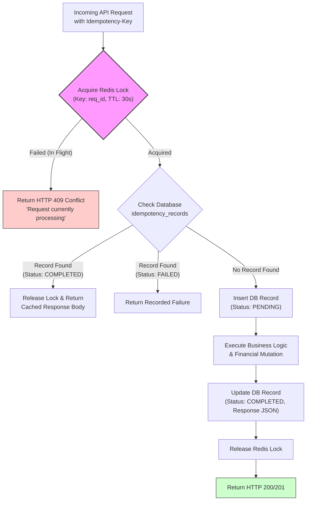
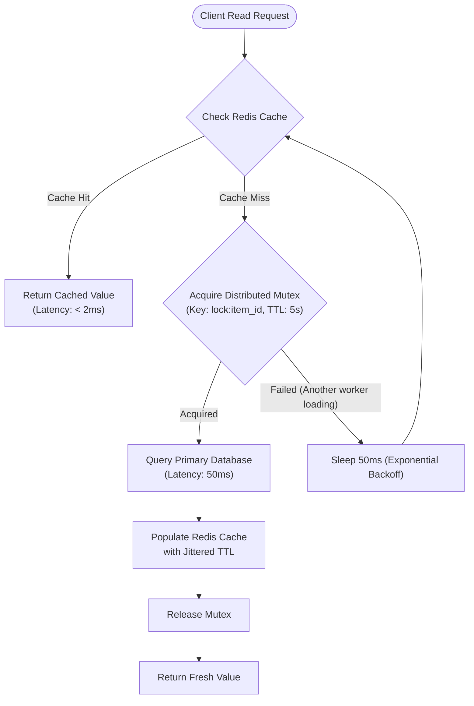

# The Connected Exhaustive Closure Teaching Methodology

## Purpose

Shallow system design instruction produces engineers who know buzzwords ("use Kafka for decoupling", "add Redis for caching") but fail in production because they cannot reason about **concurrency, failure boundaries, or state reconciliation**.

The **Connected Exhaustive Closure Methodology** enforces rigorous, first-principles causal reasoning. A mechanism or architecture is never considered "taught" until it achieves full **causal and mechanical closure**.

---

## 1. The 7-Step Causal Closure Checklist

Before concluding the explanation of any architectural component, protocol, or distributed mechanism, the tutor must verify that all 7 steps have been addressed:

### Detailed Breakdown of the 7 Steps:

#### 1. Physical & Algorithmic Constraint
- Never start with a technology name. Start with the physical reality:
  - *"RAM is volatile and expensive; magnetic disk/SSD requires sequential I/O to avoid seek penalty."*
  - *"Light takes ~67ms to travel round-trip through fiber across continents."*
  - *"Networks are asynchronous: an unacknowledged message could be lost, delayed, or executed while the caller timed out."*

#### 2. Actors & System Boundaries
- Specify the exact participants, processes, and network boundaries:
  - Which processes run on the client device? Which run on the edge proxy? Which run in the private VPC?
  - What are the communication protocols and serialization formats (e.g. gRPC over HTTP/2 with Protobuf, WebSocket, TCP)?

#### 3. The Ordered Happy Path
- Provide an unambiguous sequential trace from client trigger to persistent storage to user response.
- Must include a **visual sequence diagram or flowchart**.

#### 4. Concurrency & Race Conditions
- Trace what happens when two independent actors execute the operation at the exact same millisecond:
  - Do they overwrite each other (lost update)?
  - Is there pessimistic locking, optimistic concurrency control (OCC with version checks), or single-threaded event loop serialization?

#### 5. Fault Injection & Partial Failure
- Systematically inject faults into the design:
  - **Crash before write**: Client sends request, server dies before writing to disk.
  - **Crash after write, before ACK**: Server persists data to disk, but crashes before sending ACK over network. The client times out and retries. Does duplicate processing occur?
  - **Network Partition**: Replicas in Zone A cannot contact Zone B. Do they accept writes (split-brain) or reject writes (loss of availability)?
  - **Clock Skew**: System time on Node 1 is 500ms behind Node 2. What happens to timestamp-based ordering?

#### 6. Authoritative State & Reconciliation
- When a failure or partition heals, who owns truth?
  - Does the system use Raft consensus, two-phase commit, vector clocks with CRDTs, or an asynchronous background reconciler?
  - Show the exact repair algorithm.

#### 7. Invariants & Explicit Non-Guarantees
- Conclude with a rigorous boundary statement:
  - **Guarantees**: Exactly what invariants are preserved (e.g. *"Linearizable reads for any client reading from the elected Raft leader"*).
  - **Non-Guarantees**: What is explicitly NOT promised (e.g. *"Does NOT guarantee bounded execution time; does NOT guarantee progress if fewer than $(N/2)+1$ nodes are reachable"*).

---

## 2. Flowchart-First Pedagogy Patterns

A core drift of this studio is that **visual flowcharts lead the explanation** whenever branching or decision logic is involved.

### Pattern 1: Idempotent Write Handling Flowchart
When teaching API idempotency, do not simply describe the database table in prose. Lead with the flowchart:

### Pattern 2: Cache Read-Through with Stampede Mitigation

---

## 3. The Exhaustive Closure Acceptance Gate

Before concluding any topic, test yourself against these questions:
1. *Did I leave any "magic" component whose internal state management was not explained?*
2. *Can the student trace exactly what happens when the network cable is cut at step 3?*
3. *Did I provide a visual representation showing the decision tree or state changes?*
4. *Did I clearly differentiate what is guaranteed from what is merely hoped for?*

If any answer is "no", provide the missing causal bridge before moving to the next topic.
