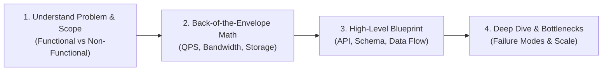

# First-Principles System Design: The Pedagogy of Longevity

## The Anti-Pattern: Ephemeral Architecture & Buzzword Decay

A chronic failure in system design education is **ephemeral pattern matching**:
* Memorizing static architectures (*"How to design Twitter"*, *"How to design Uber"*) without understanding the physical trade-offs that forced those decisions.
* Treating popular open-source software (Kafka, Redis, Cassandra, Kubernetes) as magic black boxes rather than specific implementations of immutable algorithmic primitives.
* Technology choices decay rapidly (tools change every 3-5 years), but **the laws of physics and information theory do not change**.

The System Design Studio teaches system design for **longevity** by synthesizing two complementary schools of thought:
1. **Martin Kleppmann's Mechanistic First Principles** (*Designing Data-Intensive Applications*): Bottom-up mastery of physical constraints, storage layouts, replication models, consensus, and failure modes.
2. **Alex Xu's Heuristic Problem-Solving Frameworks** (*System Design Interview*): Top-down scoping, quantitative back-of-the-envelope sizing, component boundaries, and high-stakes trade-off defense.

---

## 1. The Four Unbreakable Walls of Physics

Every distributed system is fundamentally bounded by four physical constraints:

### I. The Speed of Light & Geographic Latency
* Light in vacuum travels at $\approx 300\text{ km/ms}$; in fiber-optic glass it travels at $\approx 200\text{ km/ms}$.
* Round-trip time (RTT) between New York and London is physically bounded to $\ge 55\text{ ms}$ ($\approx 70-80\text{ ms}$ real-world transit).
* **Architectural Invariant**: No software optimization, compiler trick, or distributed framework can overcome cross-continent propagation delay. If a system requires sub-10ms cross-region writes, synchronous multi-datacenter consensus is physically impossible. You must accept asynchronous replication and handle split-brain or read-your-writes anomalies.

### II. The Storage & Memory Hierarchy (Latency Numbers Every Architect Must Know)

| Operation | Typical Latency | Scaled to Human Scale (1 CPU cycle = 1 sec) |
| :--- | :--- | :--- |
| **L1 cache reference** | $0.5\text{ ns}$ | 0.5 seconds |
| **L2 cache reference** | $7\text{ ns}$ | 7 seconds |
| **RAM access (DDR4/5)** | $100\text{ ns}$ | 1.7 minutes |
| **NVMe SSD random read** | $10\text{--}50\ \mu\text{s}$ | 2.8 to 14 hours |
| **Network packet within DC** | $500\ \mu\text{s}$ | 5.8 days |
| **Rotational HDD seek** | $1\text{--}10\text{ ms}$ | 1.1 to 11.6 days |
| **WAN round-trip (SF to NYC)** | $40\text{ ms}$ | 1.3 years |
| **WAN round-trip (US to EU)** | $80\text{ ms}$ | 2.5 years |

* **Architectural Invariant**: A single disk seek or cross-data-center network hop costs millions of CPU cycles. High-throughput architectures (LSM-trees, sequential WALs, memory-mapped buffers) turn random disk seeks into sequential appends.

### III. Unreliable Networks (The Fallacies of Distributed Computing)
* Networks drop, delay, duplicate, and reorder packets.
* Network partitions are not an anomaly to be avoided; they are an operational certainty.
* **Architectural Invariant (PACELC Theorem)**: 
  * If there is a **P**artition: you trade **A**vailability vs **C**onsistency.
  * **E**lse (normal operations): you trade **L**atency vs **C**onsistency.

### IV. The Cost of Agreement (Consensus & Ordering)
* Without a single shared physical clock, machines in a cluster cannot agree on "when" an event happened without communication.
* True consensus (Paxos, Raft, Viewstamped Replication) requires a round-trip to a majority quorum ($Q = \lfloor n/2 \rfloor + 1$).
* **Architectural Invariant**: Strong linearizable consistency across machines always incurs network round-trip latency and availability degradation when quorums cannot be formed.

---

## 2. Alex Xu's Top-Down Framework: Bounding & Sizing

Before jumping into technical mechanisms, every system must be scoped with quantitative rigor:



### The 4-Step Sizing Checklist:
1. **Traffic Volume**:
   * Peak QPS = Average QPS $\times$ Peak-to-Average Multiplier ($\approx 2\text{--}5\times$).
2. **Storage Footprint**:
   * $\text{Daily Storage} = \text{Daily Writes} \times \text{Payload Size}$.
   * Multiply by replication factor (typically $3\times$) and retention period (e.g. 5 years).
3. **Bandwidth Requirements**:
   * Inbound Bandwidth = Write QPS $\times$ Average Payload Size.
   * Outbound Bandwidth = Read QPS $\times$ Average Payload Size.
4. **Memory / Cache Capacity (The 80/20 Rule)**:
   * Cache 20% of the daily active data to serve 80% of read requests.

---

## 3. Kleppmann's Mechanistic Core: Invariants and State Transitions

Whenever a component or protocol is introduced, the tutor must establish:

```text
[ Physical Constraint ] ➔ [ Invariant Guaranteed ] ➔ [ What Can Break ] ➔ [ Recovery Protocol ]
```

### The 5 Questions of Mechanistic Rigor:
1. **Where does state live?** (In-flight socket buffer, OS page cache, NVMe disk, WAL, distributed consensus log).
2. **When is a write considered durable?** (Socket write ACK, process memory, `fsync()` to non-volatile storage, or replicated to $W$ nodes).
3. **What happens during a crash mid-operation?** (Can dirty reads occur? Does the crash-recovery sequence replay a WAL or discard partial frames?).
4. **How are concurrent mutations resolved?** (Optimistic locking with version counters, pessimistic row-level locking, two-phase locking, or last-write-wins).
5. **What is the failure blast radius?** (Single thread, single process, entire node, availability zone, or entire cluster).

---

## 4. Synthesis: How Every Topic is Structured

Every topic in the System Design Studio follows this dual Kleppmann-Xu synthesis:

1. **Top-Down Framing (Xu)**: Real-world business need, API contract, traffic profile, and back-of-the-envelope constraints.
2. **Physical Motivation (Kleppmann)**: The hardware limit or network barrier that makes trivial solutions impossible.
3. **Interactive Simulation**: Visual, step-through trace of packets, disk pages, or log replication.
4. **Invariant Matrix**: Clear contrast of guarantees vs non-guarantees.
5. **Workload Contrast**: Comparing a write-heavy telemetry workload against a consistency-critical ledger workload.
6. **Reality Check**: Testing the learner's ability to diagnose a subtle failure mode when invariants are violated.
