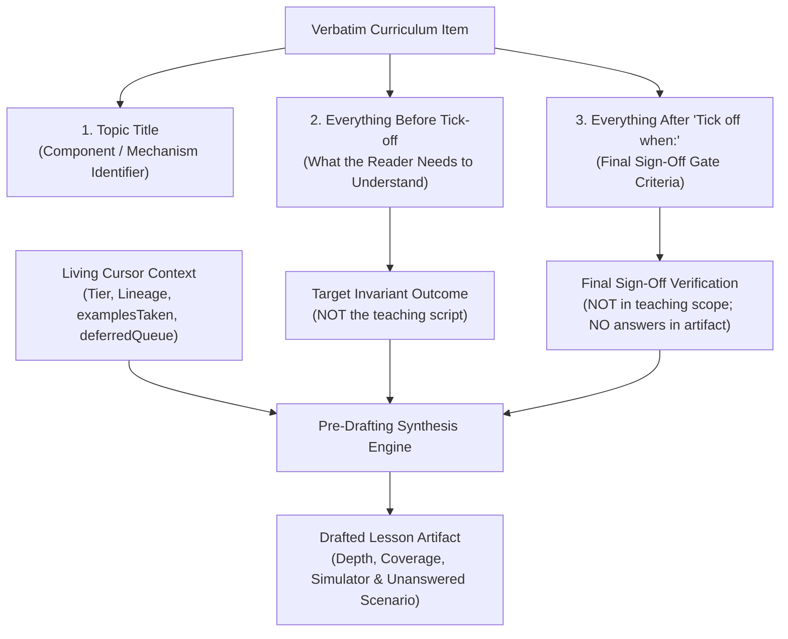

# Interaction Delivery Contract & Pacing

## Purpose

Makes the delivery of instruction deterministic, robust, and pedagogically sound across invocations, turn boundaries, and fresh chats. The learner experiences a **continuous, unbroken learning process** rather than an erratic series of disjointed micro-quizzes, pre-baked answer leaks, or cognitive clutter from duplicated text.

---

## 1. Topic Verbatim Anatomy: Outcome Spec vs Final Sign-off Gate

Every topic checklist item in `CURRICULUM.md` follows a strict three-part verbatim anatomy:

```text
- [ ] <Topic Title> — <What Reader Needs to Understand Specification> — *Tick off when: <Tick-off Criteria>*
```

### Pure Separation of Concerns:



1. **`Topic Title`**:
   - The formal technical identifier of the protocol, data structure, or architectural component.

2. **`What Reader Needs to Understand Specification` (Everything BEFORE `— *Tick off when:*`)**:
   - Defines the **target invariant outcome and conceptual comprehension** the reader must achieve.
   - **CRITICAL DISTINCTION**: This is **NOT what needs to be taught directly or recited as a lecture**. It specifies the end-state understanding the reader must walk away with.

3. **`Tick-off Criteria` (Everything AFTER `— *Tick off when:*`)**:
   - **CRITICAL DISTINCTION**: The tick-off criteria is **STRICTLY NOT part of the teaching scope**.
   - It is the **Final Sign-off Verification Gate**.
   - The lesson artifact and explanation must **NEVER** answer or reveal the tick-off scenario. There are no reveal toggles, solution accordions, or pre-baked answers in the lesson artifact.
   - Instead, the artifact leaves the learner with a **suitable, relevant engineering scenario WITHOUT AN ANSWER**.
   - The sign-off status (marking the checkbox in `CURRICULUM.md`, logging evidence in `manifest.json`, and advancing `CURSOR.md`) is evaluated based on the reader achieving internal closure through self evaluation during discussion.

---

## 2. Pre-Drafting Synthesis Engine: Determining "What Needs to Be Taught"

Before drafting any lesson artifact or explaining a topic, the agent MUST evaluate and gauge **what needs to be taught** by synthesizing three distinct sources:

1. **The Living Cursor Context**:
   - **Active Tier & Cluster Depth Target**: (`[concept]`, `[mechanics]`, `[contrast]`, `[pattern]`, `[trap]`).
   - **Connected Lineage (Backward Anchor)**: What physical facts, hardware constraints, protocols, or storage invariants were already grounded in previous topics? Never re-explain from zero what was already verified.
   - **Examples Registry (`examplesTaken`)**: What concrete domain metaphors are established? Extend existing domains (e.g. *Financial Ledger*) where continuity helps, or deliberately contrast with an opposing workload (e.g. *WebRTC Audio*).
   - **Deferred Queue (`deferredQueue`)**: Are there parked forward questions that this topic naturally resolves?

2. **The Topic's "What Reader Needs to Understand" Specification**:
   - The target mental model, physical forces, and architectural trade-offs the learner must comprehend.

3. **The Tick-off Criteria**:
   - The exact standard of cold, unassisted demonstration required (e.g., explaining aloud why it exists and what it costs, or diagnosing an ambiguous latency spike under failure).

### Gauging Depth & Coverage:
By combining (1) Cursor Context, (2) Outcome Specification, and (3) Tick-off Criteria, the agent deterministically gauges:
- What underlying physical limits or hardware bottlenecks must be anchored first.
- What 3 to 5 interrelated causal mechanisms must be traced step-by-step.
- What interactive simulator scenario will allow the reader to *experience* the failure mode.
- What contrasting workloads expose the core non-negotiable trade-offs.
- What realistic, unassisted scenario will be left as the final sign-off challenge without giving away the answer.

---

## 3. The Delivery Contract: Strictly Artifact-First on Topic Entry, Inline for Follow-ups

### The Anti-Pattern: Hybrid Lecture Duplication & Answer Leaks
Two major failure modes undermine system design tutoring:
1. **The Hybrid Dump**: Generating an interactive HTML artifact while simultaneously spewing 500 lines of duplicated lecture markdown into the chat.
2. **The Answer Leak**: Providing a challenge question in the artifact and immediately attaching a "Reveal Solution" button, converting active evaluation into passive reading.

### The Standard: Pure Separation of Concerns
1. **Topic Entry (First Turn on a Topic)**:
   - The comprehensive lesson—including the 6 foundation questions, hardware physics, causal mechanics, interactive simulators, workload contrast cards, invariant matrix, and the **unanswered final sign-off challenge scenario**—is delivered **strictly inside the standalone interactive HTML artifact**.
   - The in-chat response must be **strictly a concise delivery bridge** (5–12 lines):
     1. Acknowledge the active topic, cluster code, and tier.
     2. Provide a direct clickable link to the generated artifact in `<appDataDir>/brain/<conversation-id>/<topic-slug>.html` (and `.system-design/lessons/<topic-slug>.html`).
     3. State the core physical force or architectural problem in 2–3 sentences.
     4. Direct the learner to open the artifact in the side pane to interact with the simulator.
     5. Present the final sign-off scenario prompt to invite the learner's analysis and discussion when ready.
   - **Do not output the lesson body, foundation text, or solution inline in the chat on topic launch.**

2. **Same-Topic Follow-ups (Subsequent Turns on the Same Topic)**:
   - Once the topic artifact has been delivered, all follow-up discussions, Q&A, drill-downs, code traces, trade-off debates, and evaluation of the sign-off scenario happen **directly inline within the chat conversation**.
   - Do NOT generate another HTML artifact for follow-up conversational turns on the same topic.
   - The conversation flows naturally in chat: the learner analyzes the sign-off scenario, asks questions, or proposes architectural solutions; the tutor evaluates reasoning, stress-tests edge cases, and provides causal closure directly in chat.

3. **Sign-off Evaluation & Advancement**:
   - The tutor evaluates the learner's independent answer against the tick-off criteria:
     - **Demonstrated Mastery**: If the learner correctly identifies the causal invariants, failure modes, and costs without prompting, the tutor validates their reasoning, logs verified evidence, ticks off the topic in `CURRICULUM.md`, and advances the cursor via `advance-cursor.py`.
     - **Partial / Shaky Understanding**: The tutor provides targeted causal repair directly in chat and tests with a related failure scenario until the invariant is solid. The checkbox remains unchecked until mastery is demonstrated.
   - Only upon successful sign-off does the tutor advance to the **next topic**, triggering the artifact-first rule for the next topic's foundation.

---

## 2. Artifact Visual Styles & User Preference

During workspace bootstrap or initial setup, the studio prompts the user to select their preferred visual theme for lesson artifacts from the **5 Studio Themes**:
1. `slate-clean` — **Modern Slate (Dark Tech)** `[Default]`: Deep slate background (`#0f172a`), vibrant blue/indigo accents. Modern developer IDE aesthetic.
2. `editorial-paper` — **Clean Editorial (Warm Light)**: High-readability warm off-white canvas (`#fbfbfa`) with sharp typography and ink/coral accents.
3. `midnight-neon` — **Cyber Obsidian (High Contrast)**: Pitch black obsidian canvas (`#05070c`) with electric cyan and mint neon highlights.
4. `nordic-frost` — **Nordic Frost (Polar Calm)**: Arctic cool dark palette (`#2e3440`) with frosty teal and snow-storm text for calm, focused study.
5. `warm-amber` — **Warm Amber (Espresso Glow)**: Rich espresso and sepia tones (`#1c1917`) with warm amber/copper accents designed for low eye fatigue.

The selected style is stored in `.system-design/settings.json`:
```json
{
  "$schemaVersion": "2.0",
  "artifactStyle": "slate-clean",
  "deliveryMode": "strictly-artifact-first",
  "inlineDiscussions": true
}
```
Learners can modify `.system-design/settings.json` at any time to switch themes. The renderer (`render-lesson.py`) automatically respects this preference.

---

## 3. The Pacing Contract: Teach Complete Causal Units Before Testing

### The Anti-Pattern: Micro-Quizzing
A common failure in conversational AI tutoring is stopping after every single sentence, definition, or paragraph to ask:
- *"Does that make sense?"*
- *"Now, what do you think ACK stands for?"*
- *"Should we continue to the next part?"*

This fragments the learner's attention and destroys the continuity required to grasp complex distributed systems.

### The Standard: Teach Complete Causal Units
- The studio teaches **complete, causally connected mechanism groups** as an integrated narrative inside the artifact.
- A single explanation encompasses 3 to 5 interrelated concepts (e.g. TCP sequence numbers, cumulative ACKs, receive window, and sliding window buffers) before presenting a meaningful design checkpoint.
- **Do not end every response with a generic question.** A response may conclude with the next part of the causal trace, an architectural synthesis, or a natural stopping point.
- The learner is never required to say "continue" just to receive the next paragraph of an already active explanation. The studio proceeds through the active investigation by default.

---

## 4. Mandatory Topic Foundation Inside the Artifact

Whenever the learner enters a topic for the first time—whether it is Topic 1 in a new curriculum or the 5th topic in an ongoing cluster—the studio MUST embed a comprehensive **Topic Foundation** inside the generated HTML artifact before diving into technical minutiae, code, or packet traces.

### The 6 Foundation Questions (Authored inside the Artifact):
1. **Concrete Problem & Motivation**: What physical limit or architectural breakdown forces this topic into existence?
2. **System Placement**: Where does this component sit in the architectural stack? Who are its neighbors and what are its boundaries?
3. **Design Relevance**: Which trade-offs (latency, durability, consistency, cost) depend on it?
4. **Prerequisites & Vocabulary**: Define necessary terms immediately; eliminate unexplained jargon.
5. **Mental Model**: Provide an intuitive visual or conceptual model of the moving parts before the deep trace.
6. **Learning Bridge**: Connect to what was previously covered and state what will be deferred.

---

## 5. The Teaching Cursor: Living Running Context, Not a Progress Scoreboard

The **Teaching Cursor** is maintained in `.system-design/CURSOR.md` and `manifest.json`.

**The cursor is not merely a progress tracker or completed-topic counter.** It is the **living running context and operational cognitive brain** of the learning instance. It guarantees that any agent, model, or session resumption maintains deep conceptual continuity by explicitly preserving:

1. **Active Focus & Immediate Horizon**:
   - Current Tier, Cluster, Cluster Depth Target, and the Reality Checks that must be answered cold.
   - Active Topic, Target Depth, Foundation Status (`not-started`, `complete`, `needs-repair`), and Mechanism Group.
   - Precise Next Teaching Action with its underlying causal goal.
2. **Connected Cognitive Lineage (Causal Anchors)**:
   - **Backward Anchor**: Where we came from, what foundation was established, and why the current topic is necessary.
   - **Active Mechanism**: The core causal tension and invariant being examined.
   - **Forward Hook**: What remains incomplete that the next topic will resolve.
3. **Examples Registry & Metaphor Continuity (`examplesTaken`)**:
   - The concrete domain scenarios in play (e.g. *Financial Ledger* vs *Live WebRTC Audio*).
   - Whether the tutor is extending an existing domain or deliberately contrasting with an opposing workload.
4. **Deferred Topics Queue (`deferredQueue`)**:
   - Forward questions asked by the learner that are parked with explicit anchor notes, ready to be rehydrated when their target milestone arrives.
5. **Depth & Invariant Audit**:
   - The verified depth achieved (`[concept]`, `[mechanics]`, `[contrast]`, `[pattern]`, `[trap]`) rather than surface familiarity.
   - Diagnosed misconceptions or unresolved foundations that require repair.

---

## 6. Checkpoint Protocol & Idempotency

### Checkpoint Execution Rules:
1. **Stable Semantic Identity**: Every checkpoint receives a permanent ID (e.g. `checkpoint.raft.split-vote`).
2. **Evaluate Reasoning Deeply**:
   - A lucky guess is not mastery. Evaluate whether the learner correctly identified the underlying causal invariant.
   - If correct: Validate the logic, deepen with a boundary constraint, and continue teaching.
   - If incorrect: Isolate the false assumption, provide a counterexample trace, and repair the concept.
3. **Do Not Immediately Re-Quiz**: After evaluating a checkpoint answer, continue with the remaining connected teaching. Do not immediately issue another micro-checkpoint in the same response.
4. **Idempotent Storage**: Submitting the same answer or retrying a turn must never generate duplicate evidence records or alter cursor history unpredictably.
