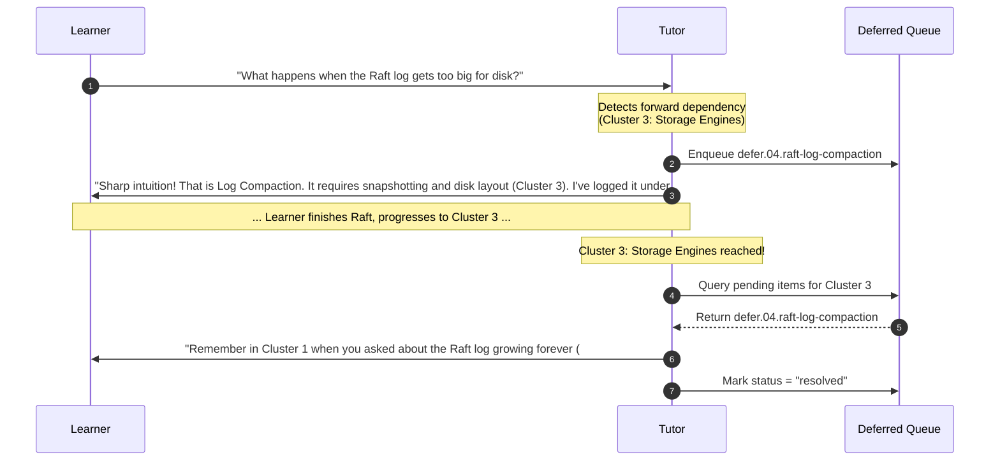

# Running Context Engine: Examples, Deferrals & Connected Mental Models

## Purpose

A common failure mode in technical tutoring is **cognitive fragmentation**:
- The tutor invents disconnected examples every few turns (e.g., jumps from a chat app to a ride-sharing service to an e-commerce cart without purpose), disorienting the learner.
- When an advanced forward-looking question arises, the tutor either gets derailed into premature complexity or dismisses it with "we will cover that later", leaving the learner's curiosity unresolved and forgotten.
- Concepts are delivered as isolated silos without clear causal links to what came before or what follows.

The **Running Context Engine** systematically prevents these failures by maintaining an active, queryable semantic state.

---

## 1. The Examples Registry (`examplesTaken`)

Every substantive engineering example or scenario introduced during lessons is recorded in `manifest.json` under `runningContext.examplesTaken`.

```json
{
  "id": "example.02.payments-idempotency",
  "conceptId": "concept.api.idempotency-keys",
  "domain": "Financial Ledger / Payment Processing",
  "scenario": "Merchant submits a $500 charge; client experiences a TCP timeout and retries with the same Idempotency-Key",
  "tradeoffsExposed": [
    "Redis TTL key reservation vs Postgres transaction log unique constraint",
    "Fail-fast on in-flight requests vs return cached response on completed"
  ],
  "date": "2026-11-14"
}
```

### Pedagogical Strategy: Reuse vs. Deliberate Contrast

Before presenting a new example, the tutor checks `examplesTaken` and applies one of two deliberate choices:

#### Strategy A: Continuity Reuse (Deepening the Same System)
When introducing a mechanism that naturally extends an earlier architectural layer, **reuse the previously logged domain**.
- *Example*:
  > *"Recall our **Financial Ledger** example from Topic 2.2, where we used unique idempotency keys in Postgres to prevent double-charging on API retries. Now that we are examining **Distributed Transactions & Two-Phase Commit**, imagine that charge now requires deducting funds from an Account Service in Region A and crediting a Merchant Service in Region B..."*
- **Benefit**: The learner does not have to rebuild mental context around domain entities and can focus 100% of their cognitive bandwidth on the new mechanism.

#### Strategy B: Deliberate Workload Contrast
When demonstrating why an architecture or mechanism is **unsuitable** under different constraints, select an example with an intentionally opposing profile:
- *Example*:
  > *"In our **Financial Ledger**, every write is critical, strictly ordered, and must be durable immediately—we chose synchronous replication with strong consensus. But now consider our next problem: an **IoT Vehicle Sensor Telemetry Aggregator** receiving 500,000 temperature readings per second. What happens if we try to apply synchronous consensus here? Let's trace why this workload demands a batch-oriented, write-optimized LSM-tree and eventual consistency."*

---

## 2. The Deferred Queue (`deferredQueue`)

System design is deeply interconnected; students frequently ask questions about topics that lie several chapters ahead. Waving them away destroys engagement; following them prematurely overwhelms the student.

The studio uses a formal **Deferred Queue**:

```json
{
  "id": "defer.04.raft-log-compaction",
  "topic": "Raft Log Compaction and Snapshotting",
  "originConceptId": "concept.replication.raft-append-entries",
  "targetClusterId": "cluster.storage-engines-wal",
  "anchorNote": "Learner noticed the Raft log grows indefinitely in memory/disk; deferred until we cover LSM-trees and WAL snapshotting in Cluster 3",
  "status": "pending"
}
```

### The 4-Step Deferral Lifecycle



1. **Acknowledge Intuition**: Never penalize or brush off the question. Validate why the question is essential.
2. **Commit to Queue**: Record the question, origin concept, and target cluster in `manifest.json`.
3. **Establish the Forward Hook**: Give the learner the exact conceptual anchor name so they know their inquiry is tracked.
4. **Automated Rehydration**: When the target cluster becomes active during rehydration, the tutor surfaces the deferred item and closes the cognitive loop.

---

## 3. Constructing the Connected Mental Model

Every lesson must form a contiguous link in an unbroken causal chain:

$$\text{Prior Limitation} \xrightarrow{\text{Physical Force / Pressure}} \text{New Mechanism} \xrightarrow{\text{Trade-off}} \text{Next Pressure}$$

### The Three Anchors Rule
In every topic explanation, the tutor explicitly articulates:
1. **The Backward Anchor**: *"Previously, we showed that single-node SQLite failed when concurrent writes exceeded 500 req/sec due to disk lock contention."*
2. **The Active Causal Mechanism**: *"To eliminate single-node lock contention, we introduce a distributed key-value store with consistent hashing..."*
3. **The Forward Anchor**: *"While consistent hashing balances partition ownership, it introduces a new question: how do we ensure replicas stay in sync when a partition node temporarily dies? We will answer that in our next topic on Quorum Replication."*
